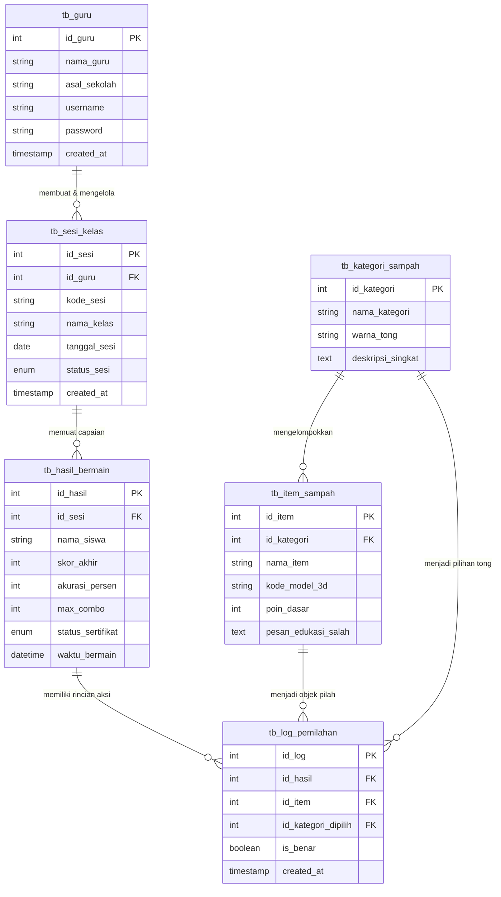

# DOKUMEN PERANCANGAN BASIS DATA & SISTEM (TAHAP 1)
**Mata Kuliah:** Rekayasa Perangkat Lunak (Kode: TINFCW243408)  
**Program Studi:** S1 Teknik Informatika, Fakultas Ilmu Komputer, Universitas Kuningan (UNIKU)  
**Tahun Akademik:** 2026/2027  

---

### IDENTITAS PROYEK
- **Judul Resmi Proyek:**  
  *"Game Edukasi Pemilahan Sampah Interaktif Berbasis Web untuk Siswa SD"*
- **Kelompok Pengembang (Kelompok 05 - SANY):**
  1. **Salwa Hamdunah** (Ketua Tim / Analis Sistem)
  2. **Novelia Audy Wijaya** (UI/UX Designer & Frontend Developer)
  3. **Yeyen Ai Nurhidayati** (Database Administrator & Data Analyst)
  4. **Arie Muhammad Syahrial** (Full-Stack & Game Logic Engineer)
- **Instansi Mitra Lapangan Nyata:**
  1. **SDN 1 Ciawilor** — Narahubung: **Bapak Agung Febriyana, S.Pd.**  
     *Fokus Integrasi:* Mendukung program pembiasaan unggulan sekolah **SEMUTLIS (Sepuluh Menit Peduli Lingkungan Sekitar)**.
  2. **SDN 2 Ciawilor** — Narahubung: **Bapak Tris Mulyo Purnomo, S.Pd.**  
     *Fokus Integrasi:* Penguatan disiplin pemilahan sampah mandiri bagi siswa fase awal (Kelas 1–3 SD, rentang usia 6–8 tahun).

---

## 1. PENDAHULUAN & ANALISIS KEBUTUHAN SISTEM

### 1.1 Latar Belakang & Urgensi Kemitraan
Masalah sampah di lingkungan sekolah dasar sering kali berakar dari rendahnya literasi praktis siswa dalam membedakan jenis material sampah, khususnya sampah plastik jajanan (*anorganik*), sisa makanan dan daun gugur (*organik*), limbah elektronik/kimia sekolah (*B3*), serta kertas/karton (*daur ulang*). 

Melalui program kemitraan nyata dengan **SDN 1 Ciawilor** dan **SDN 2 Ciawilor**, Kelompok 05 - SANY merancang media pembelajaran gamifikasi 3D yang interaktif, menyenangkan, dan berakar pada kebiasaan nyata anak-anak.

### 1.2 Analisis Kendala Lapangan & Pendekatan Arsitektur (Turn-Based Estafet)
Berdasarkan hasil observasi dan wawancara dengan guru narahubung:
1. **Aturan Larangan HP untuk Siswa SD:** Siswa kelas 1–3 SD dilarang keras membawa telepon pintar (smartphone) ke lingkungan sekolah demi ketertiban belajar.
2. **Keterbatasan Laboratorium Komputer Mandiri:** Pembelajaran tidak memungkinkan dilakukan di laboratorium komputer dengan rasio 1 siswa 1 PC.
3. **Solusi Rekayasa Perangkat Lunak:**
   Game dirancang dengan model **Sesi Kelas Estafet ("Main Bareng")**. Satu unit laptop guru yang terhubung ke proyektor kelas menjalankan game. Guru membuka **Sesi Kelas** (misalnya `Kelas 2A - SEMUTLIS`), dan siswa secara bergiliran maju bermain selama 60 detik (1 ronde).
   Pada akhir giliran, siswa menginput namanya sehingga skor, akurasi, dan log pilah per-sampah tersimpan ke sesi kelas tersebut. Guru dapat mencetak sertifikat penghargaan atau mengunduh rapor pemahaman kelas.

---

## 2. PERANCANGAN KONSEPTUAL & DIAGRAM ENTITY RELATIONSHIP (ERD)

### 2.1 Definisi 6 Entitas Utama
Basis data dirancang dengan 6 entitas yang saling berelasi secara terstruktur:
1. **`tb_guru`**: Menyimpan kredensial dan profil pendidik mitra sekolah.
2. **`tb_sesi_kelas`**: Mengelompokkan aktivitas permainan siswa berdasarkan rombongan belajar dan tanggal pelaksanaan.
3. **`tb_kategori_sampah`**: Master 4 kategori tong sampah resmi (Organik, Anorganik, B3 Berbahaya, Daur Ulang).
4. **`tb_item_sampah`**: Master bank item sampah 3D beserta narasi edukasi jika salah dipilah.
5. **`tb_hasil_bermain`**: Rekap penilaian akumulatif tiap siswa dalam suatu sesi kelas.
6. **`tb_log_pemilahan`**: Pencatatan granular setiap aksi lempar sampah (apakah benar/salah dan tong apa yang dipilih).

---

### 2.2 Diagram ERD (Mermaid Format)



---

### 2.3 Penjelasan Narasi & Semantik Relasi Antar-Entitas

1. **Relasi `tb_guru` ke `tb_sesi_kelas` (One-to-Many / 1:N):**
   - Satu orang guru (`tb_guru`) dapat membuka dan mengelola banyak sesi kelas (`tb_sesi_kelas`) sepanjang semester untuk kelas yang berbeda-beda.
   - Setiap sesi kelas wajib dimiliki oleh tepat satu orang guru penanggung jawab (*mandatory foreign key* `id_guru`).
   - *Kardinalitas:* `(1,1)` ke `(0,N)`.

2. **Relasi `tb_sesi_kelas` ke `tb_hasil_bermain` (One-to-Many / 1:N):**
   - Suatu sesi kelas (`tb_sesi_kelas`) dapat menampung hasil permainan dari banyak siswa (`tb_hasil_bermain`) yang maju bergantian secara estafet.
   - Setiap hasil bermain siswa terikat secara spesifik pada satu sesi kelas tertentu.
   - *Kardinalitas:* `(1,1)` ke `(0,N)`.

3. **Relasi `tb_hasil_bermain` ke `tb_log_pemilahan` (One-to-Many / 1:N):**
   - Setiap kali seorang siswa menyelesaikan sesi permainannya selama 60 detik (`tb_hasil_bermain`), sistem menghasilkan banyak baris log pemilahan (`tb_log_pemilahan`) yang mencatat setiap butir sampah yang sempat dipilah siswa tersebut.
   - *Kardinalitas:* `(1,1)` ke `(1,N)`.

4. **Relasi `tb_kategori_sampah` ke `tb_item_sampah` (One-to-Many / 1:N):**
   - Satu kategori sampah (`tb_kategori_sampah`) menaungi banyak variasi item sampah 3D (`tb_item_sampah`). Contoh: Kategori Anorganik menaungi botol plastik, kaleng soda, sedotan, dan mainan plastik.
   - Satu item sampah hanya memiliki satu kategori acuan yang benar secara ilmiah.
   - *Kardinalitas:* `(1,1)` ke `(1,N)`.

5. **Relasi `tb_item_sampah` ke `tb_log_pemilahan` (One-to-Many / 1:N):**
   - Satu jenis item sampah dapat muncul dan dipilah berkali-kali dalam berbagai log permainan siswa.
   - *Kardinalitas:* `(1,1)` ke `(0,N)`.

6. **Relasi `tb_kategori_sampah` ke `tb_log_pemilahan` (One-to-Many / 1:N):**
   - Kategori tempat sampah yang dipilih siswa saat bermain dicatat sebagai referensi ke `tb_kategori_sampah` untuk membandingkan pilihan siswa dengan kategori sebenarnya.
   - *Kardinalitas:* `(1,1)` ke `(0,N)`.

---

## 3. PROSES NORMALISASI DATA BERTALAP (UNF → 1NF → 2NF → 3NF)

Untuk merancang basis data yang terbebas dari anomali peremajaan, penyisipan, dan penghapusan data (*update, insert, delete anomaly*), dilakukan proses normalisasi bertahap berdasarkan dokumen mentah fisik berikut:

### 3.1 Dokumen Sumber Mentah (Contoh Form Rapor Kelas Fisik)
```text
========================================================================================
             FORM REKAPITULASI PENILAIAN PEMILAHAN SAMPAH SISWA SD
Mitra: SDN 1 Ciawilor | Program: SEMUTLIS | Guru: Agung Febriyana, S.Pd. (NIP: 1988...)
Kelas: Kelas 2A | Kode: CIAWI-2A | Tanggal: 2026-11-20
----------------------------------------------------------------------------------------
No. | Nama Siswa     | Skor | Akurasi | Rincian Pilah (Item, Tong Dipilih, Benar/Salah)
----------------------------------------------------------------------------------------
1.  | Aditya Pratama | 1420 | 92%     | (Pisang, Hijau, Benar), (Baterai, Merah, Benar),
    |                |      |         | (Bohlam, Kuning, SALAH -> Tips: Bohlam itu B3)
2.  | Siti Nur A.    | 1280 | 85%     | (Botol, Kuning, Benar), (Kardus, Biru, Benar)
========================================================================================
```

---

### 3.2 Bentuk Tidak Normal (Unnormalized Form - UNF)
Pada bentuk UNF, seluruh atribut dicatat dalam satu struktur yang mengandung grup berulang (*repeating groups*) pada kolom rincian pemilahan sampah.

$$\text{UNF} = \{ \text{KodeSesi}, \text{NamaKelas}, \text{TanggalSesi}, \text{NamaGuru}, \text{AsalSekolah}, \text{NamaSiswa}, \text{SkorAkhir}, \text{Akurasi}, (\text{NamaItem}, \text{KategoriBenar}, \text{TongDipilih}, \text{IsBenar}, \text{PesanEdukasi}) \}$$

**Anomali pada Bentuk UNF:**
- Terjadi pengulangan data informasi guru dan kelas pada setiap aksi pemilahan siswa.
- Struktur data bertingkat (*nested array*) tidak dapat disimpan langsung dalam sistem basis data relasional standar (RDBMS).

---

### 3.3 Bentuk Normal Pertama (1NF)
**Aturan 1NF:**
1. Hilangkan seluruh *repeating groups* sehingga setiap baris hanya berisi nilai atomik tunggal (*atomic value*).
2. Tentukan kunci primer komposit (*composite primary key*) yang mengidentifikasi setiap baris secara unik.

Tabel diuraikan menjadi relasi datar:

$$\text{TABEL\_1NF} = \{ \underline{\text{KodeSesi}}, \underline{\text{NamaSiswa}}, \underline{\text{NamaItem}}, \text{NamaKelas}, \text{TanggalSesi}, \text{NamaGuru}, \text{AsalSekolah}, \text{SkorAkhir}, \text{Akurasi}, \text{KategoriBenar}, \text{WarnaTong}, \text{TongDipilih}, \text{IsBenar}, \text{PesanEdukasi} \}$$

**Analisis Ketergantungan Fungsional (Functional Dependency):**
- $\text{FD}_1: \text{KodeSesi} \rightarrow \text{NamaKelas}, \text{TanggalSesi}, \text{NamaGuru}, \text{AsalSekolah}$ *(Ketergantungan Parsial)*
- $\text{FD}_2: \text{KodeSesi}, \text{NamaSiswa} \rightarrow \text{SkorAkhir}, \text{Akurasi}$ *(Ketergantungan Parsial)*
- $\text{FD}_3: \text{NamaItem} \rightarrow \text{KategoriBenar}, \text{WarnaTong}, \text{PesanEdukasi}$ *(Ketergantungan Parsial)*
- $\text{FD}_4: \text{KodeSesi}, \text{NamaSiswa}, \text{NamaItem} \rightarrow \text{TongDipilih}, \text{IsBenar}$ *(Ketergantungan Penuh)*

**Kelemahan 1NF:**
Masih terdapat **Ketergantungan Parsial (*Partial Functional Dependency*)**, di mana atribut non-kunci hanya bergantung pada sebagian kunci komposit.

---

### 3.4 Bentuk Normal Kedua (2NF)
**Aturan 2NF:**
1. Harus telah memenuhi kriteria 1NF.
2. Seluruh atribut non-kunci harus memiliki ketergantungan fungsional penuh (*Full Functional Dependency*) terhadap kunci utama (tidak ada ketergantungan parsial).

Dekomposisi dilakukan menjadi 4 entitas fungsional:
1. **`tb_sesi_kelas`**: Mengisolasi $\text{FD}_1$
   $$\{ \underline{\text{id\_sesi}}, \text{kode\_sesi}, \text{nama\_kelas}, \text{tanggal\_sesi}, \text{nama\_guru}, \text{asal\_sekolah} \}$$
2. **`tb_hasil_bermain`**: Mengisolasi $\text{FD}_2$
   $$\{ \underline{\text{id\_hasil}}, \text{id\_sesi (FK)}, \text{nama\_siswa}, \text{skor\_akhir}, \text{akurasi\_persen}, \text{max\_combo} \}$$
3. **`tb_item_sampah`**: Mengisolasi $\text{FD}_3$
   $$\{ \underline{\text{id\_item}}, \text{nama\_item}, \text{nama\_kategori}, \text{warna\_tong}, \text{pesan\_edukasi\_salah} \}$$
4. **`tb_log_pemilahan`**: Mengisolasi $\text{FD}_4$
   $$\{ \underline{\text{id\_log}}, \text{id\_hasil (FK)}, \text{id\_item (FK)}, \text{kategori\_dipilih}, \text{is\_benar} \}$$

**Kelemahan 2NF:**
Masih terdapat **Ketergantungan Transitif (*Transitive Functional Dependency*)**, yaitu atribut non-kunci bergantung pada atribut non-kunci lainnya:
- Pada tabel sesi: $\text{id\_sesi} \rightarrow \text{nama\_guru} \rightarrow \text{asal\_sekolah}$
- Pada tabel item: $\text{id\_item} \rightarrow \text{nama\_kategori} \rightarrow \text{warna\_tong}$

---

### 3.5 Bentuk Normal Ketiga (3NF)
**Aturan 3NF:**
1. Harus telah memenuhi kriteria 2NF.
2. Tidak boleh ada ketergantungan transitif antar-atribut non-kunci ($X \rightarrow Y$ dan $Y \rightarrow Z$).

Dekomposisi tahap akhir memisahkan data master guru dan kategori tempat sampah:
1. Pisahkan Guru dari Sesi Kelas:
   - **`tb_guru`** $= \{ \underline{\text{id\_guru}}, \text{nama\_guru}, \text{asal\_sekolah}, \text{username}, \text{password} \}$
   - **`tb_sesi_kelas`** $= \{ \underline{\text{id\_sesi}}, \text{id\_guru (FK)}, \text{kode\_sesi}, \text{nama\_kelas}, \text{tanggal\_sesi}, \text{status\_sesi} \}$
2. Pisahkan Kategori Sampah dari Item Sampah:
   - **`tb_kategori_sampah`** $= \{ \underline{\text{id\_kategori}}, \text{nama\_kategori}, \text{warna\_tong}, \text{deskripsi\_singkat} \}$
   - **`tb_item_sampah`** $= \{ \underline{\text{id\_item}}, \text{id\_kategori (FK)}, \text{nama\_item}, \text{kode\_model\_3d}, \text{poin\_dasar}, \text{pesan\_edukasi\_salah} \}$
3. Tabel Transaksi & Log yang Terelasi Bersih:
   - **`tb_hasil_bermain`** $= \{ \underline{\text{id\_hasil}}, \text{id\_sesi (FK)}, \text{nama\_siswa}, \text{skor\_akhir}, \text{akurasi\_persen}, \text{max\_combo}, \text{status\_sertifikat}, \text{waktu\_bermain} \}$
   - **`tb_log_pemilahan`** $= \{ \underline{\text{id\_log}}, \text{id\_hasil (FK)}, \text{id\_item (FK)}, \text{id\_kategori\_dipilih (FK)}, \text{is\_benar} \}$

**Evaluasi Anomali yang Berhasil Diselesaikan di 3NF:**
- **Anomali Penyisipan (*Insertion Anomaly*):** Guru atau kategori sampah baru dapat ditambahkan ke sistem meskipun belum ada sesi kelas atau belum ada permainan yang dimainkan.
- **Anomali Peremajaan (*Update Anomaly*):** Perubahan narasi edukasi sampah atau nama sekolah guru cukup diubah pada satu baris di tabel master tanpa risiko inkonsistensi pada data rekap nilai siswa.
- **Anomali Penghapusan (*Deletion Anomaly*):** Menghapus salah satu data siswa yang bermain tidak akan menghilangkan data master item sampah maupun profil guru mitra.

---

## 4. KAMUS DATA (DATA DICTIONARY / STRUKTUR TABEL)

### 4.1 Tabel: `tb_guru`
- **Fungsi:** Menyimpan data otentikasi dan profil pendidik mitra SDN 1 & SDN 2 Ciawilor.
- **Kunci Utama (PK):** `id_guru`

| Nama Kolom | Tipe Data & Panjang | PK/FK | Not Null | Default | Keterangan Fungsional |
| :--- | :--- | :---: | :---: | :---: | :--- |
| `id_guru` | `INT(11)` AUTO_INCREMENT | **PK** | Ya | *None* | Nomor identifikasi unik akun guru. |
| `nama_guru` | `VARCHAR(100)` | - | Ya | *None* | Nama lengkap guru beserta gelar akademik. |
| `asal_sekolah` | `VARCHAR(100)` | - | Ya | *None* | Sekolah dasar mitra (`SDN 1 Ciawilor` / `SDN 2 Ciawilor`). |
| `username` | `VARCHAR(50)` | UNIQUE | Ya | *None* | Nama pengguna unik untuk autentikasi login. |
| `password` | `VARCHAR(255)` | - | Ya | *None* | Kata sandi login guru (terenkripsi). |
| `created_at` | `TIMESTAMP` | - | Ya | `CURRENT_TIMESTAMP` | Waktu pencatatan akun ke sistem. |

---

### 4.2 Tabel: `tb_sesi_kelas`
- **Fungsi:** Mengelola sesi permainan kelas interaktif (*turn-based mode*).
- **Kunci Utama (PK):** `id_sesi` | **Kunci Asing (FK):** `id_guru`

| Nama Kolom | Tipe Data & Panjang | PK/FK | Not Null | Default | Keterangan Fungsional |
| :--- | :--- | :---: | :---: | :---: | :--- |
| `id_sesi` | `INT(11)` AUTO_INCREMENT | **PK** | Ya | *None* | Identifikasi unik sesi kelas. |
| `id_guru` | `INT(11)` | **FK** | Ya | *None* | Referensi ke guru penanggung jawab (`tb_guru.id_guru`). |
| `kode_sesi` | `VARCHAR(20)` | UNIQUE | Ya | *None* | Kode unik sesi (contoh: `CIAWI-2A`, `CIAWI2-1B`). |
| `nama_kelas` | `VARCHAR(100)` | - | Ya | *None* | Nama rombel & program (contoh: `Kelas 2A - SEMUTLIS`). |
| `tanggal_sesi` | `DATE` | - | Ya | *None* | Tanggal kegiatan pemilahan sampah di kelas. |
| `status_sesi` | `ENUM('aktif', 'selesai')`| - | Ya | `'aktif'` | Status sesi untuk menerima input skor siswa. |
| `created_at` | `TIMESTAMP` | - | Ya | `CURRENT_TIMESTAMP` | Waktu sesi dibuat oleh guru. |

---

### 4.3 Tabel: `tb_kategori_sampah`
- **Fungsi:** Master referensi 4 klasifikasi tempat sampah 3D.
- **Kunci Utama (PK):** `id_kategori`

| Nama Kolom | Tipe Data & Panjang | PK/FK | Not Null | Default | Keterangan Fungsional |
| :--- | :--- | :---: | :---: | :---: | :--- |
| `id_kategori` | `INT(11)` AUTO_INCREMENT | **PK** | Ya | *None* | Identifikasi unik kategori tong sampah (1..4). |
| `nama_kategori` | `VARCHAR(50)` | - | Ya | *None* | Label kategori (`Organik`, `Anorganik`, `B3`, `Daur Ulang`). |
| `warna_tong` | `VARCHAR(30)` | - | Ya | *None* | Kode warna visual tong sampah 3D (Hijau, Kuning, Merah, Biru). |
| `deskripsi_singkat` | `TEXT` | - | Ya | *None* | Penjelasan konsep material sampah yang masuk ke kategori ini. |

---

### 4.4 Tabel: `tb_item_sampah`
- **Fungsi:** Bank item sampah 3D yang dapat muncul di meja permainan & feedback edukasinya.
- **Kunci Utama (PK):** `id_item` | **Kunci Asing (FK):** `id_kategori`

| Nama Kolom | Tipe Data & Panjang | PK/FK | Not Null | Default | Keterangan Fungsional |
| :--- | :--- | :---: | :---: | :---: | :--- |
| `id_item` | `INT(11)` AUTO_INCREMENT | **PK** | Ya | *None* | Identifikasi unik item sampah. |
| `id_kategori` | `INT(11)` | **FK** | Ya | *None* | Kategori tempat sampah yang benar (`tb_kategori_sampah.id_kategori`). |
| `nama_item` | `VARCHAR(100)` | - | Ya | *None* | Nama benda sampah (contoh: `Kulit Pisang`, `Botol Plastik`). |
| `kode_model_3d` | `VARCHAR(50)` | - | Ya | *None* | Kunci aset 3D GLB/Three.js (contoh: `gltf_bottle`, `gltf_battery`). |
| `poin_dasar` | `INT(11)` | - | Ya | `100` | Bobot skor dasar saat berhasil dipilah dengan benar. |
| `pesan_edukasi_salah` | `TEXT` | - | Ya | *None* | Narasi penjelasan saat siswa salah memilih tong sampah. |

---

### 4.5 Tabel: `tb_hasil_bermain`
- **Fungsi:** Menyimpan hasil akhir capaian seorang siswa per giliran bermain (60 detik).
- **Kunci Utama (PK):** `id_hasil` | **Kunci Asing (FK):** `id_sesi`

| Nama Kolom | Tipe Data & Panjang | PK/FK | Not Null | Default | Keterangan Fungsional |
| :--- | :--- | :---: | :---: | :---: | :--- |
| `id_hasil` | `INT(11)` AUTO_INCREMENT | **PK** | Ya | *None* | Identifikasi unik baris hasil permainan. |
| `id_sesi` | `INT(11)` | **FK** | Ya | *None* | Referensi ke sesi kelas terkait (`tb_sesi_kelas.id_sesi`). |
| `nama_siswa` | `VARCHAR(100)` | - | Ya | *None* | Nama lengkap siswa yang bermain di laptop kelas. |
| `skor_akhir` | `INT(11)` | - | Ya | `0` | Akumulasi nilai skor akhir permainan. |
| `akurasi_persen` | `INT(11)` | - | Ya | `0` | Persentase ketepatan pilah: $(\text{Benar} / \text{Total Pilah}) \times 100\%$. |
| `max_combo` | `INT(11)` | - | Ya | `0` | Rekor rentetan pemilahan benar beruntun tanpa salah. |
| `status_sertifikat` | `ENUM('diklaim', 'belum_klaim')` | - | Ya | `'belum_klaim'` | Status apakah sertifikat digital telah diunduh/dicetak. |
| `waktu_bermain` | `DATETIME` | - | Ya | *None* | Waktu riil saat siswa menyelesaikan permainannya. |

---

### 4.6 Tabel: `tb_log_pemilahan`
- **Fungsi:** Log granular setiap keputusan pemilahan sampah untuk diagnosis evaluasi guru.
- **Kunci Utama (PK):** `id_log` | **Kunci Asing (FK):** `id_hasil`, `id_item`, `id_kategori_dipilih`

| Nama Kolom | Tipe Data & Panjang | PK/FK | Not Null | Default | Keterangan Fungsional |
| :--- | :--- | :---: | :---: | :---: | :--- |
| `id_log` | `INT(11)` AUTO_INCREMENT | **PK** | Ya | *None* | Identifikasi unik log aksi. |
| `id_hasil` | `INT(11)` | **FK** | Ya | *None* | Referensi ke hasil giliran bermain (`tb_hasil_bermain.id_hasil`). |
| `id_item` | `INT(11)` | **FK** | Ya | *None* | Sampah yang muncul di meja 3D (`tb_item_sampah.id_item`). |
| `id_kategori_dipilih` | `INT(11)` | **FK** | Ya | *None* | Tong sampah yang diklik siswa (`tb_kategori_sampah.id_kategori`). |
| `is_benar` | `TINYINT(1)` | - | Ya | `0` | Nilai boolean: `1` jika tepat, `0` jika salah tong. |
| `created_at` | `TIMESTAMP` | - | Ya | `CURRENT_TIMESTAMP` | Waktu lemparan sampah dieksekusi. |

---

## 5. STRUKTUR MENU, HAK AKSES, & PEMETAAN CRUD

### 5.1 Matriks Hak Akses Aktor (Siswa SD vs Guru Kelas)

| Fitur / Layanan Sistem | Aktor Siswa SD (Usia 6–8 Tahun) | Aktor Guru Kelas (Mitra SDN Ciawilor) |
| :--- | :---: | :---: |
| Membaca Materi Slide Edukasi & Program SEMUTLIS | ✅ Ya (Mandiri / Bimbingan) | ✅ Ya |
| Memilih & Memilah Sampah 3D (Gameplay 60s) | ✅ Ya (Estafet di Komputer Guru) | ✅ Ya (Bisa Mendemokan) |
| Mendapatkan Umpan Balik Tips Edukasi saat Salah Pilah | ✅ Ya (Otomatis Popup) | ✅ Ya |
| Mengisi Nama & Mengklaim Sertifikat Digital (PNG) | ✅ Ya | ✅ Ya (Mencetakkan untuk Siswa) |
| Melihat Papan Skor Peringkat Kelas | ✅ Ya (Leaderboard Sesi) | ✅ Ya |
| Membuat & Mengaktifkan Sesi Kelas Baru | ❌ Tidak Memiliki Akses | ✅ Ya (Penuh) |
| Menutup / Menyelesaikan Sesi Kelas | ❌ Tidak Memiliki Akses | ✅ Ya (Penuh) |
| Melihat Rapor Pemahaman Kelas & Analisis Kesalahan | ❌ Tidak Memiliki Akses | ✅ Ya (Penuh) |
| Mengunduh Rekap Penilaian Kelas ke Format CSV | ❌ Tidak Memiliki Akses | ✅ Ya (Penuh) |
| Menambah / Mengedit / Menghapus Bank Item Sampah 3D | ❌ Tidak Memiliki Akses | ✅ Ya (Penuh) |

---

### 5.2 Tabel Pemetaan Form/Layar terhadap Operasi CRUD Database

| No | Modul / Layar Tampilan | Aktor Utama | Operasi CRUD | Entitas Database Terkait | Keterangan Aksi Fungsional |
| :---: | :--- | :---: | :---: | :--- | :--- |
| **1** | **Menu Utama** (`#screen-menu`) | Siswa / Guru | **READ** | `tb_sesi_kelas` | Menampilkan nama dan kode sesi kelas yang sedang aktif di pojok atas layar. |
| **2** | **Modal Login Guru** (`#modal-teacher-login`) | Guru Mitra | **READ** | `tb_guru` | Memvalidasi kecocokan username dan password guru (termasuk tombol Quick Demo). |
| **3** | **Layar Edukasi Pre-Game** (`#screen-edu`) | Siswa | **READ** | `tb_kategori_sampah` | Membaca materi 4 warna tempat sampah dan pembiasaan program SEMUTLIS. |
| **4** | **Layar Gameplay 3D** (`#screen-game`) | Siswa | **READ** | `tb_item_sampah`, `tb_kategori_sampah` | Mengambil data item sampah aktif dari database untuk di-render dalam Three.js scene. |
| **5** | **Game Over & Simpan Skor** (`#screen-gameover`) | Siswa | **CREATE, READ** | `tb_hasil_bermain`, `tb_log_pemilahan` | Menyimpan nama siswa, skor, combo, dan seluruh log aksi pilah sampah pada sesi kelas aktif. |
| **6** | **Papan Skor Kelas** (`#modal-leaderboard`) | Siswa / Guru | **READ** | `tb_hasil_bermain`, `tb_sesi_kelas` | Menampilkan tabel 20 skor tertinggi siswa khusus pada sesi kelas yang sedang aktif. |
| **7** | **Dashboard Guru: Tab Sesi Kelas** (`#tab-sesi`) | Guru | **CREATE, READ, UPDATE, DELETE** | `tb_sesi_kelas`, `tb_guru` | Membuat sesi baru, mengubah status sesi (Aktif/Selesai), serta menghapus sesi lama. |
| **8** | **Dashboard Guru: Tab Rapor Siswa** (`#tab-rapor`) | Guru | **READ** | `tb_hasil_bermain`, `tb_log_pemilahan` | Menghitung agregasi kelas (KPI rata-rata skor, akurasi, sampah paling sering salah) dan ekspor CSV. |
| **9** | **Modal Log Siswa** (`#modal-student-log`) | Guru | **READ** | `tb_log_pemilahan`, `tb_item_sampah` | Membedah detail jawaban benar/salah tiap butir sampah untuk siswa tertentu. |
| **10**| **Dashboard Guru: Tab Bank Sampah** (`#tab-banksampah`) | Guru | **CREATE, READ, UPDATE, DELETE** | `tb_item_sampah`, `tb_kategori_sampah` | Menambah item sampah lokal sekolah, mengedit narasi edukasi salah, atau menghapus item. |

---

## 6. KESIMPULAN & PENERAPAN TAHAP SELANJUTNYA

Perancangan basis data dan modul sistem pada Tahap 1 ini telah dirumuskan secara presisi sesuai dengan:
1. **Kebutuhan Nyata Mitra Sekolah:** Model estafet 1 laptop + proyektor berhasil memecahkan kendala larangan membawa HP bagi siswa kelas 1–3 SDN 1 & SDN 2 Ciawilor.
2. **Kaidah Rekayasa Perangkat Lunak & Basis Data:** Struktur 6 tabel telah dinormalisasi hingga tahap **3NF (Third Normal Form)**, menjamin integritas data referensial dan bebas dari anomali.
3. **Kompatibilitas Lapangan Multi-Platform:** Seluruh logika basis data client-side diimplementasikan via modul non-module `dbStore.js` yang 100% kompatibel dengan protokol `file://` (offline tanpa internet) maupun server modern (Vercel/Node.js).

Dokumentasi ini siap dijadikan draf resmi untuk Laporan Proyek Rekayasa Perangkat Lunak (TINFCW243408) Kelompok 05 - SANY, Program Studi S1 Teknik Informatika Universitas Kuningan.
