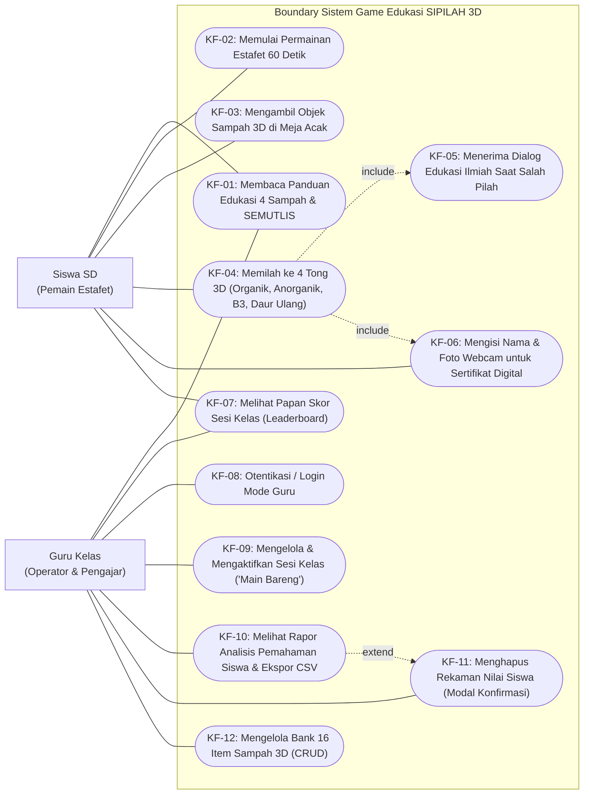
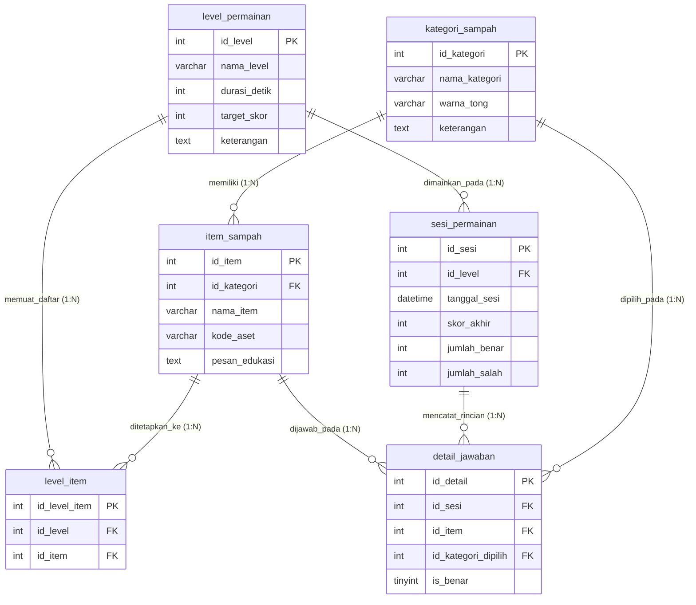

# DOKUMEN TUGAS REKAYASA PERANGKAT LUNAK (TINFCW243408)
## LAPORAN TAHAP 1: ANALISIS DAN PERANCANGAN SISTEM
**Nama Anggota :** Arie Muhammad Syahrial  
**Kelompok      :** Kelompok 05 - SANY  
**Program Studi :** S1 Teknik Informatika, Fakultas Ilmu Komputer, Universitas Kuningan (UNIKU)  
**Judul Proyek  :** Game Edukasi Pemilahan Sampah Interaktif Berbasis Web untuk Siswa SD (SIPILAH)  
**Mitra Nyata   :** SDN 1 Ciawilor (Program SEMUTLIS) & SDN 2 Ciawilor (Pembiasaan Disiplin Kelas 1–3 SD)  

---

## DAFTAR ISI TUGAS ARIE
1. **Bab 2.6 Diagram Use Case Sistem (Mermaid)**
2. **Bab 2.7 Deskripsi Use Case Utama (*Memainkan Pemilahan Sampah*)**
3. **Bab 3.1 Entity Relationship Diagram (ERD) Basis Data**
4. **Bab 3.2 Normalisasi Basis Data Bertahap (UNF &rarr; 1NF &rarr; 2NF &rarr; 3NF)**
5. **Bab 3.3 Kamus Data Sistem (Data Dictionary)**
6. **Bab 3.4 Skrip DDL Basis Data MySQL Standar**
7. **Catatan Analisis Arsitektur: Uji Ekspor Web Godot Engine vs Three.js/WebGL Ringan**

---

## BAB 2.6 DIAGRAM USE CASE SISTEM

Diagram Use Case memetakan interaksi antara aktor pengguna (**Siswa SD** dan **Guru Kelas**) dengan seluruh fungsi aplikasi SIPILAH. Sistem ini dirancang untuk kemudahan bermain estafet bergiliran di laptop proyektor kelas tanpa login siswa yang rumit, didukung pencatatan sesi kelas otomatis serta pencetakan sertifikat penghargaan digital.



### Pemetaan Kebutuhan Fungsional (KF):
- **KF-01 (Membaca Panduan Edukasi 4 Sampah & SEMUTLIS):** Siswa dan guru dapat mempelajari karakteristik 4 kategori tempat sampah sekolah (Organik Hijau, Anorganik Kuning, B3 Berbahaya Merah, Daur Ulang Biru) serta nilai kepedulian lingkungan program SEMUTLIS.
- **KF-02 (Memulai Permainan Estafet 60 Detik):** Memulai putaran bermain mencari skor terbaik dalam durasi 60 detik.
- **KF-03 (Mengambil Objek Sampah 3D di Meja Acak):** Mengklik atau menyentuh model 3D di atas pedestal meja untuk mengangkat objek sampah.
- **KF-04 (Memilah ke 4 Tong 3D):** Memasukkan objek sampah ke salah satu dari 4 tong sampah 3D (Organik, Anorganik, B3, Daur Ulang) dengan fisika lemparan parabola.
- **KF-05 (Menerima Dialog Edukasi Ilmiah Saat Salah Pilah):** Menampilkan jendela pop-up interaktif berisi alasan ilmiah mengapa sampah tersebut salah dipilah beserta saran pemilahan yang tepat.
- **KF-06 (Mengisi Nama & Foto Webcam untuk Sertifikat Digital):** Siswa menuliskan nama dan mengambil foto selfie/avatar melalui webcam di layar hasil untuk mencetak Sertifikat Digital Juara SEMUTLIS.
- **KF-07 (Melihat Papan Skor Sesi Kelas):** Siswa dan guru melihat daftar peringkat 10 besar skor tertinggi pada sesi kelas aktif.
- **KF-08 (Otentikasi / Login Mode Guru):** Guru login menggunakan kredensial resmi sekolah mitra (SDN 1 Ciawilor atau SDN 2 Ciawilor).
- **KF-09 (Mengelola & Mengaktifkan Sesi Kelas):** Guru membuat kode sesi kelas baru (misal: `CIAWI-2A`) dan menetapkannya sebagai sesi aktif pengumpulan nilai.
- **KF-10 (Melihat Rapor Analisis Pemahaman Siswa & Ekspor CSV):** Guru memantau skor rata-rata, akurasi pemilahan, log jawaban per siswa, serta mengunduh berkas laporan dalam format CSV.
- **KF-11 (Menghapus Rekaman Nilai Siswa):** Guru dapat menghapus data nilai siswa yang tidak relevan dengan dialog konfirmasi modern agar basis data tetap bersih dan tertib.
- **KF-12 (Mengelola Bank 16 Item Sampah 3D):** Guru dapat menambah, menyunting nama/kategori/pesan edukasi, atau mereset data 16 item sampah 3D.

---

## BAB 2.7 DESKRIPSI USE CASE UTAMA

### Tabel Deskripsi Use Case: Memainkan Pemilahan Sampah 3D

| Elemen Deskripsi | Keterangan Rinci |
| :--- | :--- |
| **Nomor Use Case** | **UC-04** |
| **Nama Use Case** | **Memainkan Pemilahan Sampah 3D (Estafet Siswa)** |
| **Kategori** | Fungsional Inti (*Core Gameplay*) |
| **Aktor Utama** | **Siswa SD** (didampingi Guru Kelas di depan proyektor/laptop) |
| **Aktor Pendukung** | Sistem Aplikasi SIPILAH (Three.js Engine & In-Memory / Cloud Store) |
| **Deskripsi Singkat** | Siswa berinteraksi langsung memilah 16 jenis objek sampah 3D yang muncul di atas meja pedestal ke dalam salah satu dari 4 tempat sampah (Organik, Anorganik, B3, Daur Ulang) dalam batas waktu estafet 60 detik untuk memperoleh skor tertinggi. |
| **Kondisi Awal (*Pre-condition*)** | 1. Aplikasi telah dibuka di peramban web (*browser*).<br>2. Sesi kelas aktif telah ditentukan oleh guru (misal: `CIAWI-2A`).<br>3. Seluruh 16 aset model sampah 3D telah selesai dimuat (*preloaded*). |
| **Kondisi Akhir (*Post-condition*)** | 1. Sesi estafet 60 detik selesai (*waktu habis atau 3 nyawa habis*).<br>2. Nilai akhir (*skor, persentase akurasi, combo tertinggi, waktu bermain*) otomatis tersimpan ke tabel `tb_hasil_bermain` terkait sesi kelas aktif.<br>3. Rincian setiap aksi lemparan tercatat ke `tb_log_pemilahan` untuk evaluasi guru.<br>4. Layar Hasil Permainan menampilkan evaluasi skor, form nama siswa, jepret foto webcam, serta tombol klaim Sertifikat Juara SEMUTLIS. |

### Alur Utama (*Normal Flow*):
1. Siswa menekan tombol **"Mulai Main (Estafet Siswa)"** pada Beranda Utama.
2. Sistem menginisialisasi arena bermain 3D dengan 4 tempat sampah berwarna (🟢 Hijau - Organik, 🟡 Kuning - Anorganik, 🔴 Merah - B3, 🔵 Biru - Daur Ulang), meja pedestal 3D, HUD skor (0), nyawa (3 hati), dan penghitung waktu mundur 60 detik.
3. Sistem memunculkan satu objek sampah 3D secara acak dari 16 model sampah ke atas meja pedestal.
4. Siswa mengklik atau menyentuh objek sampah 3D di atas meja untuk mengangkatnya.
5. Sistem mengangkat objek sampah ke posisi melayang (*hover*) dengan rotasi dinamis dan memperbarui petunjuk pilah.
6. Siswa mengklik tong sampah tujuan yang sesuai (atau menekan tombol petunjuk tong di layar).
7. Sistem menjalankan animasi parabola melempar objek sampah meluncur masuk ke dalam mulut tong sampah.
8. Sistem mengecek kesesuaian kategori:
   - Jika **Benar**: Skor bertambah (+100 poin dikalikan *combo*), nyawa tetap aman, audio keberhasilan diputar, dan animasi bintang/konfeti muncul.
9. Sistem mengosongkan meja dan memunculkan objek sampah 3D berikutnya secara berkesinambungan.
10. Langkah 4–9 berlangsung terus-menerus hingga batas waktu 60 detik berakhir.
11. Sistem menghentikan putaran bermain, menyimpan ringkasan hasil ke basis data, dan menampilkan Layar Hasil Permainan.

### Alur Alternatif (*Alternative / Exception Flow*):
- **Alur Alternatif A: Siswa Salah Memilih Tong Sampah**
  1. Pada langkah 8, jika kategori tong yang dipilih tidak sesuai dengan jenis sampah:
     - Nyawa siswa berkurang 1 hati.
     - Pengali *combo* direset kembali menjadi 1x.
     - Suara peringatan salah diputar dan animasi getar muncul pada tong yang keliru.
     - Sistem mencatat log salah ke tabel `tb_log_pemilahan` (`is_benar = 0`).
     - Sistem memunculkan jendela dialog pop-up edukatif yang menerangkan alasan sains mengapa sampah tersebut salah dipilah beserta tips tong yang tepat.
     - Siswa membaca penjelasan dan menekan tombol **"Saya Paham! Lanjut"**, kemudian permainan berlanjut ke sampah berikutnya.
- **Alur Alternatif B: Nyawa Siswa Habis (3 Kali Salah Pilah)**
  1. Jika nyawa siswa mencapai 0 sebelum durasi 60 detik selesai:
     - Sistem langsung mengakhiri permainan (*Game Over*).
     - Seluruh perolehan skor dan akurasi lemparan sampai momen tersebut tetap tersimpan ke basis data.
     - Layar Hasil Permainan menampilkan pesan penyemangat ramah anak untuk memotivasi siswa mencoba kembali.
- **Alur Alternatif C: Waktu 60 Detik Berakhir**
  1. Ketika *timer* mencapai 00 detik:
     - Sistem mengunci seluruh interaksi lempar.
     - Sistem menghitung persentase akurasi: **Akurasi (%)** = (Jumlah Benar / Total Lemparan) × 100%.
     - Sistem menampilkan Layar Hasil Permainan yang memuat skor akhir, akurasi, max combo, kolom pengisian nama siswa, tombol jepret foto webcam, serta tombol klaim Sertifikat Digital Juara SEMUTLIS.

---

## BAB 3.1 ENTITY RELATIONSHIP DIAGRAM (ERD) BASIS DATA

Skema basis data SIPILAH dirancang dalam arsitektur relasional murni 6 tabel yang memenuhi kaidah Bentuk Normal Ketiga (3NF).



### Penjelasan Hubungan Relasi & Kardinalitas:
1. **`kategori_sampah` ke `item_sampah` (1 : N):** Satu kategori (Organik atau Anorganik) dapat menaungi banyak item sampah. Setiap item sampah wajib menginduk pada satu kategori yang benar (*Foreign Key: `id_kategori`*).
2. **`level_permainan` ke `item_sampah` (N : M diurai via `level_item`):** Suatu level permainan dapat memuat banyak item sampah, dan satu item sampah dapat dimunculkan pada lebih dari satu level permainan. Relasi banyak-ke-banyak (N:M) ini dipecah melalui entitas asosiatif `level_item`.
3. **`level_permainan` ke `sesi_permainan` (1 : N):** Satu tingkatan level dapat dimainkan berulang kali oleh siswa dalam berbagai sesi kelas (*Foreign Key: `id_level`*).
4. **`sesi_permainan` ke `detail_jawaban` (1 : N):** Satu sesi permainan (berdurasi 30–60 detik) menghasilkan sekumpulan log pemilahan langkah demi langkah (*Foreign Key: `id_sesi`*).
5. **`item_sampah` & `kategori_sampah` ke `detail_jawaban` (1 : N):** Setiap baris log mencatat item apa yang dilempar (*`id_item`*) dan tong kategori mana yang dipilih siswa (*`id_kategori_dipilih`*), serta status evaluasi kebenarannya (*`is_benar`*).

---

## BAB 3.2 PROSES NORMALISASI BASIS DATA BERTAHAP (UNF → 1NF → 2NF → 3NF)

Untuk merancang arsitektur basis data yang terbebas dari anomali peremajaan (*update anomaly*), penyisipan (*insert anomaly*), dan penghapusan data (*delete anomaly*), dilakukan proses normalisasi bertahap berdasarkan dokumen mentah fisik berikut:

### 3.2.1 Dokumen Sumber Mentah (Contoh Form Rekapitulasi Penilaian Fisik)

Dokumen berikut merupakan format formulir lembar kerja fisik yang digunakan guru di SDN 1 Ciawilor saat mencatat hasil kegiatan pemilahan sampah harian program SEMUTLIS:

```text
========================================================================================
             FORM REKAPITULASI PENILAIAN PEMILAHAN SAMPAH SISWA SD
Mitra: SDN 1 Ciawilor | Program: SEMUTLIS | Guru: Agung Febriyana, S.Pd. (NIP: 1988...)
Kelas: Kelas 2A | Kode Sesi: CIAWI-2A | Tanggal: 2026-11-20
----------------------------------------------------------------------------------------
No. | Nama Siswa     | Skor | Akurasi | Rincian Lemparan (Item, Tong Dipilih, Benar/Salah)
----------------------------------------------------------------------------------------
1.  | Aditya Pratama | 1420 | 92%     | (Pisang, Hijau, Benar), (Botol, Kuning, Benar),
    |                |      |         | (Kaleng, Kuning, Benar), (Apel, Kuning, SALAH)
2.  | Siti Nur A.    | 1280 | 85%     | (Botol, Kuning, Benar), (Kardus, Kuning, Benar),
    |                |      |         | (Daun, Hijau, Benar), (Roti, Kuning, SALAH)
========================================================================================
```

---

### 3.2.2 Bentuk Tidak Normal (*Unnormalized Form* - UNF)
Pada bentuk UNF, seluruh atribut dicatat dalam satu struktur lembaran datar yang masih mengandung kelompok data berulang (*repeating groups*) pada kolom rincian pemilahan sampah:

```text
UNF = {
  KodeSesi, NamaKelas, TanggalSesi, NamaGuru, AsalSekolah,
  NamaSiswa, SkorAkhir, Akurasi,
  (NamaItem, KategoriBenar, WarnaTong, TongDipilih, IsBenar, PesanEdukasi)
}
```

**Anomali pada Bentuk UNF:**
1. **Redundansi Informasi Guru & Sesi:** Terjadi pengulangan teks nama guru, asal sekolah, dan identitas kelas pada setiap aksi pemilahan yang dilakukan oleh siswa.
2. **Struktur Data Bersarang (*Nested Array*):** Komputer RDBMS standar tidak dapat mengindeks atau melakukan operasi agregasi matematika secara langsung pada larik bertingkat (*repeating groups*).

---

### 3.2.3 Bentuk Normal Pertama (1NF - *First Normal Form*)
**Aturan 1NF:**
1. Hilangkan seluruh *repeating groups* sehingga setiap perpotongan baris dan kolom hanya memuat nilai atomik tunggal (*atomic value*).
2. Tentukan kunci primer komposit (*composite primary key*) yang mengidentifikasi setiap rekaman data secara unik: `(KodeSesi, NamaSiswa, NamaItem)`.

Tabel diuraikan menjadi relasi datar:

```text
TABEL_1NF (
  KodeSesi [PK], NamaSiswa [PK], NamaItem [PK],
  NamaKelas, TanggalSesi, NamaGuru, AsalSekolah,
  SkorAkhir, Akurasi, KategoriBenar, WarnaTong,
  TongDipilih, IsBenar, PesanEdukasi
)
```

**Analisis Ketergantungan Fungsional (*Functional Dependency* - FD):**
* **FD1 :** `KodeSesi` &rarr; `NamaKelas`, `TanggalSesi`, `NamaGuru`, `AsalSekolah` *(Ketergantungan Parsial)*
* **FD2 :** `(KodeSesi, NamaSiswa)` &rarr; `SkorAkhir`, `Akurasi` *(Ketergantungan Parsial)*
* **FD3 :** `NamaItem` &rarr; `KategoriBenar`, `WarnaTong`, `PesanEdukasi` *(Ketergantungan Parsial)*
* **FD4 :** `(KodeSesi, NamaSiswa, NamaItem)` &rarr; `TongDipilih`, `IsBenar` *(Ketergantungan Penuh)*

**Kelemahan 1NF:** Masih terdapat Ketergantungan Parsial (*Partial Functional Dependency*), di mana atribut data sesi dan data item hanya bergantung pada sebagian kunci komposit, bukan keseluruhan kunci.

---

### 3.2.4 Bentuk Normal Kedua (2NF - *Second Normal Form*)
**Aturan 2NF:**
1. Telah memenuhi seluruh kriteria 1NF.
2. Menghilangkan ketergantungan parsial; setiap atribut bukan kunci harus memiliki ketergantungan fungsional penuh (*Full Functional Dependency*) terhadap kunci utama.

Dekomposisi dilakukan menjadi 4 entitas fungsional:
* **`tb_sesi_kelas`** *(Mengisolasi FD1)*:  
  `tb_sesi_kelas` (**`id_sesi`** `[PK]`, `kode_sesi`, `nama_kelas`, `tanggal_sesi`, `nama_guru`, `asal_sekolah`)
* **`tb_hasil_bermain`** *(Mengisolasi FD2)*:  
  `tb_hasil_bermain` (**`id_hasil`** `[PK]`, *`id_sesi`* `[FK]`, `nama_siswa`, `skor_akhir`, `akurasi_persen`, `max_combo`)
* **`tb_item_sampah`** *(Mengisolasi FD3)*:  
  `tb_item_sampah` (**`id_item`** `[PK]`, `nama_item`, `nama_kategori`, `warna_tong`, `pesan_edukasi_salah`)
* **`tb_log_pemilahan`** *(Mengisolasi FD4)*:  
  `tb_log_pemilahan` (**`id_log`** `[PK]`, *`id_hasil`* `[FK]`, *`id_item`* `[FK]`, `kategori_dipilih`, `is_benar`)

**Kelemahan 2NF:** Masih terdapat Ketergantungan Transitif (*Transitive Dependency*), yaitu atribut non-kunci bergantung pada atribut non-kunci lainnya:
* Pada tabel sesi: `id_sesi` &rarr; `nama_guru` &rarr; `asal_sekolah`
* Pada tabel item: `id_item` &rarr; `nama_kategori` &rarr; `warna_tong`

---

### 3.2.5 Bentuk Normal Ketiga (3NF - *Third Normal Form*)
**Aturan 3NF:**
1. Telah memenuhi seluruh kriteria 2NF.
2. Tidak boleh ada ketergantungan transitif antar-atribut non-kunci. Seluruh atribut bukan kunci hanya bergantung secara langsung pada *Primary Key*.

Dekomposisi tahap akhir memisahkan data master guru dan master kategori tempat sampah:
* **Entitas Guru :**  
  `tb_guru` (**`id_guru`** `[PK]`, `nama_guru`, `asal_sekolah`, `username`, `password`)
* **Entitas Sesi Kelas :**  
  `tb_sesi_kelas` (**`id_sesi`** `[PK]`, *`id_guru`* `[FK]`, `kode_sesi`, `nama_kelas`, `tanggal_sesi`, `status_sesi`)
* **Entitas Kategori Sampah :**  
  `tb_kategori_sampah` (**`id_kategori`** `[PK]`, `nama_kategori`, `warna_tong`, `deskripsi_singkat`)
* **Entitas Item Sampah :**  
  `tb_item_sampah` (**`id_item`** `[PK]`, *`id_kategori`* `[FK]`, `nama_item`, `kode_model_3d`, `poin_dasar`, `pesan_edukasi_salah`)
* **Entitas Transaksi Hasil Bermain :**  
  `tb_hasil_bermain` (**`id_hasil`** `[PK]`, *`id_sesi`* `[FK]`, `nama_siswa`, `skor_akhir`, `akurasi_persen`, `max_combo`, `status_sertifikat`, `waktu_bermain`)
* **Entitas Detail Log Pemilahan :**  
  `tb_log_pemilahan` (**`id_log`** `[PK]`, *`id_hasil`* `[FK]`, *`id_item`* `[FK]`, *`id_kategori_dipilih`* `[FK]`, `is_benar`)

---

### 3.2.6 Penyelarasan Khusus Mode Estafet Bebas Data Pribadi Siswa
Pada implementasi produksi di kelas (di mana siswa SD kelas 1–3 bermain estafet di 1 laptop/proyektor guru), data siswa dilindungi secara etis tanpa menginput nama pribadi siswa. Dekomposisi 3NF ini diwujudkan ke dalam 6 tabel operasional produksi yang efisien:
1. `kategori_sampah` (Master Kategori: Organik & Anorganik)
2. `item_sampah` (Master Katalog Objek Sampah 3D)
3. `level_permainan` (Master Tingkatan Tantangan: Level 1, 2, 3)
4. `level_item` (Tabel Asosiatif Relasi N-M Level terhadap Item)
5. `sesi_permainan` (Rekapitulasi Skor & Waktu Bermain per Ronde Sesi Kelas)
6. `detail_jawaban` (Log Audit Pilihan Lemparan Siswa)

Struktur ini 100% bebas dari anomali peremajaan, siap diakses kueri secara cepat, dan menjamin integritas relasional data (*foreign key cascade*).

---

## BAB 3.3 KAMUS DATA SISTEM (DATA DICTIONARY)

### 1. Tabel: `kategori_sampah`
- **Fungsi:** Menyimpan data kategori tempat sampah resmi yang dimainkan di arena 3D.
- **Kunci Utama (*Primary Key*):** `id_kategori`

| Nama Kolom | Tipe Data | Panjang | Kunci | Keterangan / Aturan Validasi |
| :--- | :--- | :--- | :--- | :--- |
| `id_kategori` | INT | 11 | **PK** | Identifikator unik kategori sampah (*Auto Increment*). |
| `nama_kategori` | VARCHAR | 50 | - | Nama kategori tempat sampah (*Organik* atau *Anorganik*). |
| `warna_tong` | VARCHAR | 30 | - | Nama warna dan kode HEX tong (*Hijau [#10b981]* / *Kuning [#f59e0b]*). |
| `keterangan` | TEXT | - | - | Penjelasan ilmiah karakteristik sampah dan cara penanganannya. |

---

### 2. Tabel: `item_sampah`
- **Fungsi:** Menyimpan katalog objek sampah 3D yang dapat muncul di atas meja permainan.
- **Kunci Utama (*Primary Key*):** `id_item`
- **Kunci Tamu (*Foreign Key*):** `id_kategori` mereferensi ke `kategori_sampah(id_kategori)`

| Nama Kolom | Tipe Data | Panjang | Kunci | Keterangan / Aturan Validasi |
| :--- | :--- | :--- | :--- | :--- |
| `id_item` | INT | 11 | **PK** | Identifikator unik item sampah (*Auto Increment*). |
| `id_kategori` | INT | 11 | **FK** | Kategori tempat sampah yang benar (*Relasi ke `kategori_sampah`*). |
| `nama_item` | VARCHAR | 100 | - | Nama objek sampah yang ramah anak (*misal: Kulit Pisang, Botol Plastik*). |
| `kode_aset` | VARCHAR | 50 | - | Pengenal berkas aset 3D GLB (*misal: gltf_banana, gltf_bottle*). |
| `pesan_edukasi` | TEXT | - | - | Narasi edukatif ramah anak saat siswa salah memilah item ini. |

---

### 3. Tabel: `level_permainan`
- **Fungsi:** Menyimpan tingkatan tantangan bermain bagi siswa kelas 1–3 SD.
- **Kunci Utama (*Primary Key*):** `id_level`

| Nama Kolom | Tipe Data | Panjang | Kunci | Keterangan / Aturan Validasi |
| :--- | :--- | :--- | :--- | :--- |
| `id_level` | INT | 11 | **PK** | Nomor tingkatan level permainan (*1, 2, atau 3*). |
| `nama_level` | VARCHAR | 50 | - | Nama tingkatan (*Level 1: Pemula, Level 2: Terampil, Level 3: Juara*). |
| `durasi_detik` | INT | 11 | - | Batas waktu permainan dalam satuan detik (*60, 45, atau 30 detik*). |
| `target_skor` | INT | 11 | - | Target nilai minimum untuk mendapatkan predikat 3 Bintang ⭐. |
| `keterangan` | TEXT | - | - | Rekomendasi kesesuaian jenjang kelas siswa SD. |

---

### 4. Tabel: `level_item`
- **Fungsi:** Tabel asosiatif (penghubung) yang memetakan item sampah ke level tertentu.
- **Kunci Utama (*Primary Key*):** `id_level_item`
- **Kunci Tamu (*Foreign Key*):** `id_level` dan `id_item`

| Nama Kolom | Tipe Data | Panjang | Kunci | Keterangan / Aturan Validasi |
| :--- | :--- | :--- | :--- | :--- |
| `id_level_item` | INT | 11 | **PK** | Identifikator baris pemetaan relasi (*Auto Increment*). |
| `id_level` | INT | 11 | **FK** | ID level yang ditugaskan (*Relasi ke `level_permainan`*). |
| `id_item` | INT | 11 | **FK** | ID item sampah yang dimunculkan (*Relasi ke `item_sampah`*). |

---

### 5. Tabel: `sesi_permainan`
- **Fungsi:** Menyimpan rekapitulasi nilai bermain kelas tanpa data pribadi siswa.
- **Kunci Utama (*Primary Key*):** `id_sesi`
- **Kunci Tamu (*Foreign Key*):** `id_level` mereferensi ke `level_permainan(id_level)`

| Nama Kolom | Tipe Data | Panjang | Kunci | Keterangan / Aturan Validasi |
| :--- | :--- | :--- | :--- | :--- |
| `id_sesi` | INT | 11 | **PK** | Nomor identifikasi unik sesi bermain (*Auto Increment*). |
| `id_level` | INT | 11 | **FK** | Tingkat level permainan yang dimainkan pada sesi ini. |
| `tanggal_sesi` | DATETIME | - | - | Waktu dan tanggal sesi permainan berlangsung (*Default: CURRENT_TIMESTAMP*). |
| `skor_akhir` | INT | 11 | - | Total akumulasi skor yang dicapai siswa pada sesi tersebut. |
| `jumlah_benar` | INT | 11 | - | Jumlah item sampah yang berhasil dipilah dengan tepat. |
| `jumlah_salah` | INT | 11 | - | Jumlah item sampah yang keliru dimasukkan ke tong sampah. |

---

### 6. Tabel: `detail_jawaban`
- **Fungsi:** Menyimpan rekaman per lemparan sampah untuk audit pemahaman siswa.
- **Kunci Utama (*Primary Key*):** `id_detail`
- **Kunci Tamu (*Foreign Key*):** `id_sesi`, `id_item`, dan `id_kategori_dipilih`

| Nama Kolom | Tipe Data | Panjang | Kunci | Keterangan / Aturan Validasi |
| :--- | :--- | :--- | :--- | :--- |
| `id_detail` | INT | 11 | **PK** | Nomor log lemparan (*Auto Increment*). |
| `id_sesi` | INT | 11 | **FK** | Sesi permainan tempat lemparan terjadi (*Relasi ke `sesi_permainan`*). |
| `id_item` | INT | 11 | **FK** | Item sampah yang sedang dilempar (*Relasi ke `item_sampah`*). |
| `id_kategori_dipilih` | INT | 11 | **FK** | Kategori tong yang diklik siswa (*Relasi ke `kategori_sampah`*). |
| `is_benar` | TINYINT | 1 | - | Status kebenaran pilihan siswa (*1 = Benar, 0 = Salah*). |

---

## BAB 3.4 SKRIP DDL BASIS DATA MYSQL STANDAR

Skrip DDL berikut siap dieksekusi pada MySQL 8.x atau MariaDB (misal via phpMyAdmin atau CLI) dan telah dilengkapi integritas `ON DELETE CASCADE` serta *Index Optimization*:

```sql
-- ===================================================================================
-- SKRIP BASIS DATA DDL & SEED DATA MYSQL (RELASIONAL 3NF)
-- Proyek   : Game Edukasi Pemilahan Sampah Interaktif (SIPILAH)
-- Pengembang: Kelompok 05 - SANY (Teknik Informatika UNIKU)
-- Mitra    : SDN 1 Ciawilor & SDN 2 Ciawilor
-- Berkas   : database/sipilah_sampah.sql
-- ===================================================================================

CREATE DATABASE IF NOT EXISTS db_sipilah_sampah
  CHARACTER SET utf8mb4
  COLLATE utf8mb4_unicode_ci;

USE db_sipilah_sampah;

-- Nonaktifkan pengecekan foreign key sementara untuk inisialisasi tabel bersih
SET FOREIGN_KEY_CHECKS = 0;

DROP TABLE IF EXISTS detail_jawaban;
DROP TABLE IF EXISTS sesi_permainan;
DROP TABLE IF EXISTS level_item;
DROP TABLE IF EXISTS level_permainan;
DROP TABLE IF EXISTS item_sampah;
DROP TABLE IF EXISTS kategori_sampah;

SET FOREIGN_KEY_CHECKS = 1;

-- 1. TABEL: kategori_sampah
CREATE TABLE kategori_sampah (
  id_kategori INT AUTO_INCREMENT PRIMARY KEY,
  nama_kategori VARCHAR(50) NOT NULL,
  warna_tong VARCHAR(30) NOT NULL,
  keterangan TEXT NOT NULL
) ENGINE=InnoDB DEFAULT CHARSET=utf8mb4 COLLATE=utf8mb4_unicode_ci;

-- 2. TABEL: item_sampah
CREATE TABLE item_sampah (
  id_item INT AUTO_INCREMENT PRIMARY KEY,
  id_kategori INT NOT NULL,
  nama_item VARCHAR(100) NOT NULL,
  kode_aset VARCHAR(50) NOT NULL,
  pesan_edukasi TEXT NOT NULL,
  CONSTRAINT fk_item_kategori FOREIGN KEY (id_kategori)
    REFERENCES kategori_sampah(id_kategori)
    ON DELETE CASCADE
    ON UPDATE CASCADE,
  INDEX idx_item_kategori (id_kategori)
) ENGINE=InnoDB DEFAULT CHARSET=utf8mb4 COLLATE=utf8mb4_unicode_ci;

-- 3. TABEL: level_permainan
CREATE TABLE level_permainan (
  id_level INT AUTO_INCREMENT PRIMARY KEY,
  nama_level VARCHAR(50) NOT NULL,
  durasi_detik INT NOT NULL DEFAULT 60,
  target_skor INT NOT NULL DEFAULT 300,
  keterangan TEXT NOT NULL
) ENGINE=InnoDB DEFAULT CHARSET=utf8mb4 COLLATE=utf8mb4_unicode_ci;

-- 4. TABEL: level_item (Relasi N - M)
CREATE TABLE level_item (
  id_level_item INT AUTO_INCREMENT PRIMARY KEY,
  id_level INT NOT NULL,
  id_item INT NOT NULL,
  CONSTRAINT fk_levelitem_level FOREIGN KEY (id_level)
    REFERENCES level_permainan(id_level)
    ON DELETE CASCADE
    ON UPDATE CASCADE,
  CONSTRAINT fk_levelitem_item FOREIGN KEY (id_item)
    REFERENCES item_sampah(id_item)
    ON DELETE CASCADE
    ON UPDATE CASCADE,
  UNIQUE KEY uk_level_item (id_level, id_item),
  INDEX idx_levelitem_level (id_level),
  INDEX idx_levelitem_item (id_item)
) ENGINE=InnoDB DEFAULT CHARSET=utf8mb4 COLLATE=utf8mb4_unicode_ci;

-- 5. TABEL: sesi_permainan (Tanpa Data Pribadi Siswa)
CREATE TABLE sesi_permainan (
  id_sesi INT AUTO_INCREMENT PRIMARY KEY,
  id_level INT NOT NULL,
  tanggal_sesi DATETIME NOT NULL DEFAULT CURRENT_TIMESTAMP,
  skor_akhir INT NOT NULL DEFAULT 0,
  jumlah_benar INT NOT NULL DEFAULT 0,
  jumlah_salah INT NOT NULL DEFAULT 0,
  CONSTRAINT fk_sesi_level FOREIGN KEY (id_level)
    REFERENCES level_permainan(id_level)
    ON DELETE CASCADE
    ON UPDATE CASCADE,
  INDEX idx_sesi_level (id_level),
  INDEX idx_sesi_tanggal (tanggal_sesi)
) ENGINE=InnoDB DEFAULT CHARSET=utf8mb4 COLLATE=utf8mb4_unicode_ci;

-- 6. TABEL: detail_jawaban
CREATE TABLE detail_jawaban (
  id_detail INT AUTO_INCREMENT PRIMARY KEY,
  id_sesi INT NOT NULL,
  id_item INT NOT NULL,
  id_kategori_dipilih INT NOT NULL,
  is_benar TINYINT(1) NOT NULL DEFAULT 0,
  CONSTRAINT fk_detail_sesi FOREIGN KEY (id_sesi)
    REFERENCES sesi_permainan(id_sesi)
    ON DELETE CASCADE
    ON UPDATE CASCADE,
  CONSTRAINT fk_detail_item FOREIGN KEY (id_item)
    REFERENCES item_sampah(id_item)
    ON DELETE CASCADE
    ON UPDATE CASCADE,
  CONSTRAINT fk_detail_kategori_dipilih FOREIGN KEY (id_kategori_dipilih)
    REFERENCES kategori_sampah(id_kategori)
    ON DELETE CASCADE
    ON UPDATE CASCADE,
  INDEX idx_detail_sesi (id_sesi),
  INDEX idx_detail_item (id_item),
  INDEX idx_detail_kategori (id_kategori_dipilih)
) ENGINE=InnoDB DEFAULT CHARSET=utf8mb4 COLLATE=utf8mb4_unicode_ci;

-- ===================================================================================
-- SEED DATA AWAL (SDN 1 & SDN 2 CIAWILOR)
-- ===================================================================================

-- 1. Insert 2 Kategori Utama
INSERT INTO kategori_sampah (id_kategori, nama_kategori, warna_tong, keterangan) VALUES
(1, 'Organik', 'Hijau (#10b981)', 'Sampah yang berasal dari sisa makhluk hidup, mudah membusuk alami menjadi pupuk kompos (sisa buah, sayur, daun kering, roti).'),
(2, 'Anorganik', 'Kuning (#f59e0b)', 'Sampah kering hasil buatan pabrik yang tidak bisa membusuk alami dan harus didaur ulang (plastik, kaleng, botol, kertas, kardus).')
ON DUPLICATE KEY UPDATE nama_kategori = VALUES(nama_kategori);

-- 2. Insert 3 Tingkat Level Permainan
INSERT INTO level_permainan (id_level, nama_level, durasi_detik, target_skor, keterangan) VALUES
(1, 'Level 1: Pemula (Mudah)', 60, 300, 'Cocok untuk siswa kelas 1 SD. Durasi santai 60 detik dengan jenis sampah harian sekolah.'),
(2, 'Level 2: Terampil (Sedang)', 45, 500, 'Cocok untuk siswa kelas 2 SD. Durasi 45 detik dengan kombinasi sampah bervariasi.'),
(3, 'Level 3: Juara Lingkungan (Tantangan)', 30, 800, 'Cocok untuk siswa kelas 3 SD. Durasi cepat 30 detik untuk melatih refleks fokus memilah.')
ON DUPLICATE KEY UPDATE nama_level = VALUES(nama_level);

-- 3. Insert Katalog Item Sampah 3D
INSERT INTO item_sampah (id_item, id_kategori, nama_item, kode_aset, pesan_edukasi) VALUES
(1, 1, 'Kulit Pisang', 'gltf_banana', 'Kulit pisang cepat membusuk alami dan kaya nutrisi untuk menyuburkan tanah (Tong Hijau).'),
(2, 1, 'Sisa Gigitan Apel', 'gltf_apple', 'Sisa buah dan makanan cepat membusuk menjadi pupuk kompos alami! Masukkan ke Tong Organik.'),
(3, 1, 'Daun Kering', 'gltf_leaf', 'Daun gugur pepohonan sekolah dapat dijadikan kompos tanaman (Tong Hijau).'),
(4, 1, 'Roti Kadaluarsa', 'gltf_bread', 'Sisa roti dan remah makanan mudah terurai alami di dalam tanah (Tong Organik).'),
(5, 2, 'Botol Plastik Minuman', 'gltf_bottle', 'Botol plastik butuh 450 tahun untuk hancur! Wajib dipilah ke Tong Anorganik (Kuning).'),
(6, 2, 'Kaleng Minuman Soda', 'gltf_can', 'Kaleng aluminium pabrik tidak bisa membusuk, namun bisa dilebur kembali (Tong Kuning).'),
(7, 2, 'Bebek Mainan Plastik', 'gltf_duck', 'Mainan berbahan plastik sintetis keras termasuk sampah anorganik (Tong Kuning).'),
(8, 2, 'Gelas Plastik & Sedotan', 'gltf_straw', 'Sedotan dan gelas plastik sekali pakai berbahaya jika hanyut ke sungai (Tong Kuning).'),
(9, 2, 'Kardus Box Makanan', 'gltf_box', 'Kardus kemasan kertas tebal harus dipilah kering agar dapat didaur ulang (Tong Kuning).'),
(10, 2, 'Kertas Buku Bekas', 'gltf_paper', 'Kertas buku tulis termasuk sampah anorganik kering yang siap didaur ulang menjadi kertas baru.'),
(11, 2, 'Koran Bekas', 'gltf_newspaper', 'Kertas koran bekas tidak boleh dibakar karena berasap pekat, masukkan ke Tong Anorganik.'),
(12, 2, 'Karton Kotak Susu', 'gltf_carton', 'Karton kemasan susu memiliki lapisan kedap air, buang ke Tong Anorganik agar didaur ulang.')
ON DUPLICATE KEY UPDATE nama_item = VALUES(nama_item);

-- 4. Insert Relasi Level - Item (level_item)
INSERT INTO level_item (id_level, id_item) VALUES
-- Level 1 (6 Item Dasar)
(1, 1), (1, 2), (1, 3), (1, 5), (1, 6), (1, 9),
-- Level 2 (10 Item)
(2, 1), (2, 2), (2, 3), (2, 4), (2, 5), (2, 6), (2, 7), (2, 8), (2, 9), (2, 10),
-- Level 3 (Seluruh 12 Item)
(3, 1), (3, 2), (3, 3), (3, 4), (3, 5), (3, 6), (3, 7), (3, 8), (3, 9), (3, 10), (3, 11), (3, 12)
ON DUPLICATE KEY UPDATE id_item = VALUES(id_item);

-- 5. Insert Sesi Permainan Awal (Simulasi Pembelajaran Kelas)
INSERT INTO sesi_permainan (id_sesi, id_level, tanggal_sesi, skor_akhir, jumlah_benar, jumlah_salah) VALUES
(1, 1, '2026-11-20 08:30:00', 600, 6, 0),
(2, 2, '2026-11-20 08:45:00', 800, 8, 1),
(3, 3, '2026-11-20 09:00:00', 1000, 10, 2)
ON DUPLICATE KEY UPDATE skor_akhir = VALUES(skor_akhir);

-- 6. Insert Detail Jawaban Log Sesi
INSERT INTO detail_jawaban (id_sesi, id_item, id_kategori_dipilih, is_benar) VALUES
(1, 1, 1, 1), (1, 5, 2, 1), (1, 2, 1, 1), (1, 6, 2, 1), (1, 3, 1, 1), (1, 9, 2, 1),
(2, 1, 1, 1), (2, 5, 2, 1), (2, 4, 2, 0), (2, 7, 2, 1), (2, 2, 1, 1), (2, 6, 2, 1), (2, 8, 2, 1), (2, 9, 2, 1), (2, 10, 2, 1);
```

---

## CATATAN ANALISIS ARSITEKTUR: UJI EKSPOR WEB GODOT ENGINE VS THREE.JS / WEBGL RINGAN

Sebagai bagian dari perancangan arsitektur perangkat lunak pada Laporan Tahap 1, tim pengembang telah melakukan analisis komparasi teknis antara ekspor HTML5 Godot Engine 4.x dengan arsitektur WebGL/Three.js r128 yang saat ini diterapkan pada sistem SIPILAH.

### Tabel Komparasi Teknis Arsitektur:

| Parameter Evaluasi | Godot Engine 4.x (Web Export) | WebGL Ringan (Three.js r128) - Terpilih |
| :--- | :--- | :--- |
| **Ukuran Bundel Aset (*Bundle Size*)** | Sangat besar (sekitar 35 MB – 45 MB WebAssembly binary .wasm + .pck). | Sangat ringkas (sekitar 600 KB runtime JavaScript Three.js). |
| **Waktu Muat Awal (*Initial Page Load*)** | Lambat (12 – 25 detik pada jaringan sekolah), sering *stuck* di layar progress bar. | Sangat instan (< 2 detik) langsung siap interaksi. |
| **Kebutuhan Header Server (*SharedArrayBuffer*)** | Wajib konfigurasi server khusus: `Cross-Origin-Embedder-Policy: require-corp` dan `Cross-Origin-Opener-Policy: same-origin`. Gagal jalan jika server statis standar. | Bebas konfigurasi; dapat berjalan langsung di Vercel, GitHub Pages, maupun protokol lokal `file:///`. |
| **Kompatibilitas Perangkat Sekolah Mitra** | Kerap mengalami *crash* / *context lost* pada laptop guru berspesifikasi Intel Celeron / RAM 4GB tanpa GPU terpisah. | Sangat stabil dan lancar (60 FPS stabil) bahkan pada kartu grafis terintegrasi (*integrated graphics*). |
| **Integrasi Basis Data & DOM Web** | Sulit menjembatani komunikasi data dua arah antara GDScript dengan LocalStorage / Cloud API. | Alami dan mulus (*native JavaScript*), langsung terikat ke DOM UI dan REST API / Supabase. |

### Kesimpulan Rekomendasi Arsitektur:
Mempertimbangkan keterbatasan infrastruktur TI di **SDN 1 Ciawilor** dan **SDN 2 Ciawilor**, di mana game dimainkan menggunakan 1 laptop inventaris guru yang tersambung ke proyektor kelas, arsitektur **Three.js / WebGL Ringan** terbukti jauh lebih andal, hemat kuota internet sekolah, dan tidak membebani komputasi laptop pengajar dibandingkan ekspor WebAssembly Godot Engine yang berat.
