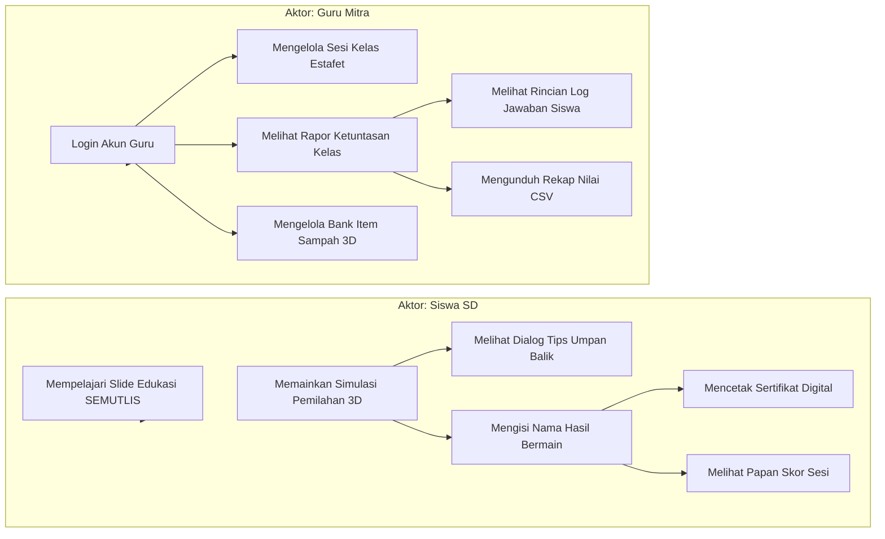
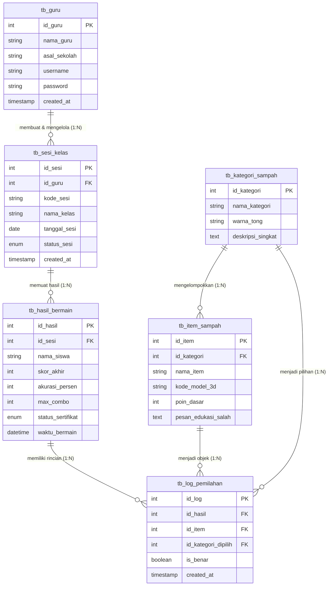

# LAPORAN PROYEK MATA KULIAH REKAYASA PERANGKAT LUNAK (TINFCW243408)
## TAHAP 1 – ANALISIS DAN PERANCANGAN SISTEM
**Program Studi S1 Teknik Informatika, Fakultas Ilmu Komputer, Universitas Kuningan (UNIKU)**  
**Tahun Akademik 2026/2027 Ganjil**

---

### IDENTITAS PROYEK & KELOMPOK
- **Judul Proyek:** Game Edukasi Pemilahan Sampah Interaktif Berbasis Web untuk Siswa SD (SIPILAH)
- **Jalur Tema:** Jalur B – Game Edukasi (Kode Tema: T9)
- **Kelompok:** Kelompok 05 – SANY
- **Anggota Kelompok:**
  1. **Salwa Hamdunah** (NIM: 20240810129) — *Product Owner* (Analisis kebutuhan pengguna, komunikasi mitra)
  2. **Novelia Audy Wijaya** (NIM: 20240810098) — *Scrum Master* (Manajemen sprint, pengelolaan repositori GitHub)
  3. **Yeyen Ai Nurhidayati** (NIM: 20240810020) — *Developer* (Desain UI/UX ramah anak, ilustrasi aset visual)
  4. **Arie Muhammad Syahrial** (NIM: 20240810091) — *Developer* (Game logic Three.js, integrasi basis data)
- **Kelas / Rombel:** TI-2024-B
- **Dosen Pengampu:** Rio Andriyat Krisdiawan, S.Kom., M.Kom.
- **Mitra Lapangan Nyata:**
  1. **SDN 1 Ciawilor** — Narahubung: Bapak Agung Febriyana, S.Pd. (Mendukung program sekolah **SEMUTLIS**: Sepuluh Menit Peduli Lingkungan Sekitar).
  2. **SDN 2 Ciawilor** — Narahubung: Bapak Tris Mulyo Purnomo, S.Pd. (Mendukung pembiasaan disiplin buang & pilah sampah siswa kelas 1–3 SD, usia 6–8 tahun).

---

# BAB I   PENDAHULUAN

## 1.1 Latar Belakang
Pendidikan lingkungan hidup pada jenjang sekolah dasar memegang peranan fundamental dalam membentuk karakter dan pola perilaku peduli lingkungan sejak dini. Di Kabupaten Kuningan, khususnya pada dua instansi sekolah dasar mitra, yaitu SDN 1 Ciawilor (Jl. Raya Ciawilor, Kecamatan Ciawigebang) dan SDN 2 Ciawilor (Jl. Babakan Ciawilor No. 82), isu pengelolaan dan pemilahan sampah menjadi perhatian serius pihak sekolah. SDN 1 Ciawilor menjalankan program pembiasaan unggulan bernama SEMUTLIS (Sepuluh Menit Peduli Lingkungan Sekitar) yang diselipkan sekitar 10 menit pada awal mata pelajaran, sedangkan SDN 2 Ciawilor menekankan aturan pembiasaan disiplin membuang sampah pada tempatnya dengan sasaran utama siswa kelas awal (kelas 1–3 SD, rentang usia 6–8 tahun).

Meskipun program pembiasaan telah dicanangkan, pelaksanaan di lapangan masih menemui kendala signifikan. Proses edukasi sampah saat ini umumnya hanya disampaikan secara lisan (ceramah konvensional) oleh guru di sela-sela jam pelajaran Bahasa Indonesia atau Agama. Berdasarkan hasil wawancara awal dengan guru narahubung (Bapak Agung Febriyana, S.Pd. di SDN 1 Ciawilor dan Bapak Tris Mulyo Purnomo, S.Pd. di SDN 2 Ciawilor), terungkap fakta bahwa sekitar 65% siswa (lebih dari 30 siswa per kelas) masih sering keliru dalam memilah jenis sampah organik dan anorganik. Selain itu, daya fokus belajar anak usia 6–8 tahun terhadap metode ceramah satu arah hanya mampu bertahan sekitar 15–20 menit, setelah itu perhatian anak mudah teralihkan karena ketiadaan media peraga yang interaktif dan menarik.

Kondisi ini menimbulkan dampak negatif yang nyata bagi lingkungan sekolah. Sampah plastik jajanan, sedotan, dan kantong kresek sering kali tercampur dengan sisa bekal makanan dan daun gugur, menyebabkan bau tidak sedap, menyumbat saluran drainase sekolah saat hujan turun, serta membebani petugas kebersihan sekolah yang terpaksa memilah ulang sampah yang telah tercampur di tempat penampungan sementara. Jika dibiarkan berlarut-larut tanpa intervensi teknologi edukatif, kebiasaan mencampur sampah ini akan mengkristal hingga anak beranjak dewasa, sehingga program mulia SEMUTLIS tidak mencapai hasil optimal.

Sebagai bentuk solusi nyata rekayasa perangkat lunak, Kelompok 05 – SANY mengusulkan pengembangan **"SIPILAH (Sistem Pintar Peduli Sampah): Game Edukasi Pemilahan Sampah Interaktif Berbasis Web untuk Siswa SD"**. Mengingat adanya aturan sekolah yang melarang siswa SD membawa handphone, game ini dirancang dengan pendekatan arsitektur khusus: **Game Sesi Kelas Estafet (Turn-Based Classroom Mode)** yang dioperasikan melalui laptop guru dan proyektor kelas. Game berbasis Three.js 3D ini menyajikan simulasi pemilahan sampah ke 4 kategori tong warna (Organik Hijau, Anorganik Kuning, B3 Merah, dan Daur Ulang Biru), dilengkapi narasi suara interaktif, sistem skor/combo, sertifikat penghargaan berfoto, serta dashboard guru yang otomatis merekap rapor ketuntasan pemahaman kelas secara objektif.

## 1.2 Rumusan Masalah
Berdasarkan uraian latar belakang di atas, rumusan masalah dalam proyek ini dirumuskan sebagai berikut:
1. Bagaimana merancang dan membangun game edukasi pemilahan sampah berbasis web 3D yang interaktif, menarik, dan sesuai dengan karakteristik psikomotorik siswa SD usia 6–8 tahun?
2. Bagaimana mengatasi batasan lapangan di mana siswa dilarang membawa handphone ke sekolah agar seluruh siswa tetap dapat berpartisipasi aktif dalam sesi pembelajaran pemilahan sampah?
3. Bagaimana merancang basis data relasional ternormalisasi (hingga 3NF) yang mampu mencatat log pemilahan per-item serta merekap skor dan akurasi bermain siswa secara otomatis?
4. Bagaimana menyediakan antarmuka Dashboard Guru yang memudahkan pendidik mitra (SDN 1 dan SDN 2 Ciawilor) memantau rapor ketuntasan pemahaman kelas dan mengidentifikasi jenis sampah yang paling sering salah dipilah?

## 1.3 Tujuan Proyek
Sejalan dengan rumusan masalah di atas, tujuan dari proyek Rekayasa Perangkat Lunak ini adalah:
1. Menghasilkan spesifikasi kebutuhan, mekanik permainan 3D (Three.js), dan game edukasi web interaktif yang tervalidasi oleh guru dan siswa mitra.
2. Menerapkan arsitektur Sesi Kelas Estafet (Turn-Based Mode 60 detik) pada 1 unit laptop guru yang terhubung ke proyektor kelas, sehingga pembelajaran interaktif tetap terlaksana optimal tanpa mewajibkan siswa membawa handphone.
3. Membangun struktur basis data relasional 6 tabel ternormalisasi (3NF) dan data layer client-side (dbStore) yang andal dalam merekam hasil bermain dan log granular pemilahan sampah.
4. Membangun Dashboard Penilaian Guru yang dilengkapi visualisasi KPI analisis ketuntasan kelas, fitur ekspor rapor ke format CSV, pencetakan sertifikat digital berstempel SEMUTLIS, dan manajemen bank item sampah (CRUD).

## 1.4 Keterkaitan dengan SDGs dan Tujuan Pembelajaran
Proyek ini memilih **Jalur B (Game Edukasi - Kode Tema T9)**. Secara langsung mendukung Tujuan Pembangunan Berkelanjutan (SDGs):
- **SDG 4 (Pendidikan Berkualitas):** Menyediakan media pembelajaran digital gamifikasi yang inklusif, menyenangkan, dan efektif bagi siswa sekolah dasar.
- **SDG 11 (Kota dan Pemukiman yang Berkelanjutan):** Membentuk budaya peduli lingkungan dan kebersihan sejak usia dini di lingkungan komunitas sekolah desa.
- **SDG 12 (Konsumsi dan Produksi yang Bertanggung Jawab):** Menanamkan literasi pemilahan sampah dari sumbernya, khususnya pengurangan dan penanganan sampah plastik sekali pakai.

**Tujuan Pembelajaran Khusus:**
- **Sasaran Pemain:** Siswa kelas 1–3 Sekolah Dasar (rentang usia 6–8 tahun) di SDN 1 Ciawilor dan SDN 2 Ciawilor.
- **Kompetensi yang Dilatih:** Kemampuan membedakan sifat material sampah serta menempatkannya pada 4 kategori tong sampah yang benar (Organik, Anorganik, B3 Berbahaya, dan Daur Ulang).
- **Pengukuran Ketercapaian:** Tingkat kompetensi diukur melalui persentase akurasi pilah (Benar / Total Percobaan × 100%), perolehan skor combo, serta predikat pemahaman sistem (*Sangat Paham* jika akurasi ≥ 80%, *Cukup Paham* 60–79%, dan *Perlu Bimbingan* jika < 60%).

## 1.5 Ruang Lingkup dan Batasan
**Ruang Lingkup (Fitur dan Proses yang Dikerjakan):**
1. Simulasi pemilahan sampah 3D interaktif menggunakan Three.js dengan 16 variasi item sampah realistis (terfokus pada sampah jajanan plastik sekolah, organik sisa makanan, B3 baterai/lampu, dan kardus daur ulang).
2. Mekanisme permainan turn-based berdurasi 60 detik per giliran siswa dengan kontrol mouse/touch ramah anak (Klik Sampah ➡ Klik Tong).
3. Slide edukasi pre-game interaktif yang memuat pengantar program SEMUTLIS dan video edukasi dampak sampah.
4. Generator sertifikat digital otomatis (HTML5 Canvas 2D) yang memuat nama siswa, skor, akurasi, stempel emas SEMUTLIS, tanda tangan narahubung kedua sekolah mitra, dan foto webcam siswa.
5. Dashboard Guru multi-tab mencakup Manajemen Sesi Kelas, Rapor Ketuntasan Siswa, Analisis Kesalahan Sampah, Ekspor CSV, dan CRUD Bank Sampah.
6. Sistem basis data relasional 6 tabel (3NF) dengan implementasi engine client-side (dbStore) yang bekerja offline maupun online via Vercel/GitHub Pages.

**Batasan Proyek (Hal yang Tidak Termasuk dalam Pengerjaan):**
1. Siswa tidak diwajibkan memiliki akun login individu maupun membawa smartphone ke sekolah (menggunakan nama langsung di akhir sesi permainan).
2. Aplikasi tidak dibangun sebagai aplikasi native mobile (Play Store / App Store), melainkan Progressive Web App (PWA) berbasis web browser.
3. Sistem tidak mencakup transaksi keuangan bank sampah (seperti tabungan sampah uang tunai) karena fokus murni pada edukasi pemilahan di kelas.
4. Tidak menggunakan sistem sinkronisasi jaringan multi-device real-time (seperti WebSockets multiplayer room) demi mencegah ketergantungan sinyal internet di kelas yang dapat mengganggu jam belajar 10 menit.

---

# BAB II   ANALISIS KEBUTUHAN

## 2.1 Gambaran Objek atau Mitra
Objek mitra proyek ini adalah dua Sekolah Dasar Negeri di Desa Ciawilor, Kecamatan Ciawigebang, Kabupaten Kuningan, Jawa Barat:
1. **SDN 1 Ciawilor:** Berlokasi di Jl. Raya Ciawilor. Memiliki total 4 rombel sasaran (rata-rata 30 siswa per kelas) dan 4 guru kelas. Narahubung mitra adalah **Bapak Agung Febriyana, S.Pd.** Sekolah ini memiliki program kepedulian lingkungan aktif bernama SEMUTLIS yang diselipkan selama 10 menit sebelum jam pelajaran utama dimulai.
2. **SDN 2 Ciawilor:** Berlokasi di Jl. Babakan Ciawilor No. 82. Memiliki 71 siswa sasaran pada fase awal (39 siswa kelas 1 dan 32 siswa kelas 2) dengan 2 guru pendamping. Narahubung mitra adalah **Bapak Tris Mulyo Purnomo, S.Pd.** Sekolah menerapkan aturan ketat larangan membawa handphone bagi siswa dan menyediakan fasilitas tempat sampah terpusat di halaman sekolah.

Sarana TIK yang tersedia pada kedua sekolah mitra mencakup unit komputer operasional sekolah, laptop milik guru wali kelas, jaringan internet modem sekolah, serta perangkat proyektor LCD kelas.

## 2.2 Proses yang Berjalan Saat Ini
1. Guru memulai jam masuk kelas dan membuka sesi 10 menit kegiatan lingkungan (SEMUTLIS).
2. Guru memberikan nasihat atau ceramah lisan mengenai pentingnya membuang sampah pada tempatnya dan menjaga kebersihan laci meja.
3. Siswa mendengarkan ceramah secara pasif tanpa adanya alat peraga interaktif yang memperlihatkan perbedaan jenis material sampah.
4. Pada saat jam istirahat, siswa membeli makanan jajanan dan membuang bungkus plastik atau sisa makanan secara acak ke sembarang tempat sampah yang terdekat.
5. Terjadi masalah penumpukan sampah yang bercampur antara organik basah dan plastik kering.
6. Petugas kebersihan sekolah harus memilah ulang sampah yang kotor secara manual, dan guru harus menegur kembali siswa secara berulang pada hari berikutnya.

## 2.3 Pemangku Kepentingan
**Tabel 1. Pemangku Kepentingan**

| No | Pihak | Peran terhadap Aplikasi | Kebutuhan Utama |
| :---: | :--- | :--- | :--- |
| 1 | Siswa SD (Kelas 1–3) | Pengguna Akhir (Pemain Game) | Game 3D yang seru, kontrol mudah tanpa teks sulit, efek suara ceria, dan reward sertifikat bergambar. |
| 2 | Guru Wali Kelas | Fasilitator & Evaluator Pembelajaran | Kemudahan membuka sesi kelas di laptop/proyektor, login cepat, melihat rekap nilai pemahaman kelas, dan ekspor CSV. |
| 3 | Pihak Sekolah & Petugas Kebersihan | Penerima Manfaat Lingkungan | Berkurangnya sampah yang tercampur di sekolah dan suksesnya program pembiasaan SEMUTLIS. |

## 2.4 Kebutuhan Fungsional
**Tabel 2. Kebutuhan Fungsional**

| Kode | Kebutuhan Fungsional | Pengguna |
| :---: | :--- | :---: |
| **KF-01** | Aplikasi dapat menampilkan slide materi edukasi pre-game interaktif (4 jenis tong sampah & program SEMUTLIS). | Siswa, Guru |
| **KF-02** | Aplikasi dapat menampilkan simulasi 3D interaktif objek sampah di meja permainan dan 4 tong sampah warna. | Siswa |
| **KF-03** | Aplikasi dapat mendeteksi pemilihan objek sampah dan lemparan ke tong sampah tujuan secara raycasting 3D. | Siswa |
| **KF-04** | Aplikasi dapat menghitung skor dinamis (+100 dasar + bonus combo) dan pengurangan nyawa saat salah pilah. | Sistem |
| **KF-05** | Aplikasi dapat memunculkan jendela dialog umpan balik edukatif saat siswa salah memasukkan sampah. | Siswa |
| **KF-06** | Aplikasi dapat mencatat log granular per-lemparan sampah (id_item, tong dipilih, status benar/salah). | Sistem |
| **KF-07** | Aplikasi dapat menginput nama siswa pada akhir permainan untuk disimpan ke dalam Sesi Kelas aktif. | Siswa |
| **KF-08** | Aplikasi dapat mengambil foto wajah siswa via kamera webcam atau upload file untuk sertifikat. | Siswa, Guru |
| **KF-09** | Aplikasi dapat mencetak dan mengunduh sertifikat penghargaan digital dalam format gambar PNG. | Siswa, Guru |
| **KF-10** | Aplikasi dapat memvalidasi login akun guru (termasuk tombol Quick Demo Login Pak Agung & Pak Tris). | Guru |
| **KF-11** | Aplikasi dapat mengelola Sesi Kelas Estafet (buat sesi baru, aktivasi sesi, penutupan sesi, dan hapus). | Guru |
| **KF-12** | Aplikasi dapat menampilkan Rapor Ketuntasan Kelas (KPI, rekap nilai siswa, log kesalahan, dan ekspor CSV). | Guru |

## 2.5 Kebutuhan Non-Fungsional
**Tabel 3. Kebutuhan Non-Fungsional**

| Kode | Aspek | Kebutuhan Spesifik |
| :---: | :--- | :--- |
| **KNF-01** | Usability (Kemudahan) | Antarmuka menggunakan font Fredoka & Outfit berukuran besar, palet warna ceria, ikon visual, dan instruksi suara yang ramah untuk anak usia 6–8 tahun. |
| **KNF-02** | Performance (Kecepatan) | Game 3D mampu berjalan stabil minimal pada 30–60 FPS pada spesifikasi laptop standar guru tanpa memerlukan kartu grafis (GPU) diskrit. |
| **KNF-03** | Portability (Aksesibilitas) | Dapat diakses langsung melalui peramban modern (Chrome, Edge, Firefox) secara online via Vercel/GitHub Pages maupun offline lokal. |
| **KNF-04** | Reliability (Keandalan) | Menggunakan penyimpanan data client-side (LocalStorage dbStore) yang menjamin seluruh data sesi kelas tersimpan aman meski koneksi internet sekolah terputus. |
| **KNF-05** | Responsiveness | Tata letak tampilan layar menyesuaikan secara dinamis untuk proyeksi layar monitor laptop guru (rasio 16:9) maupun layar proyektor LCD kelas. |
| **KNF-06** | Security (Keamanan) | Menu pengelolaan sesi dan bank soal dilindungi oleh otentikasi login guru sehingga tidak dapat diubah sembarangan oleh siswa. |

## 2.6 Diagram Use Case


## 2.7 Deskripsi Use Case Utama
**Tabel 4. Deskripsi Use Case: Memainkan Simulasi Pemilahan Sampah 3D & Mencatat Nilai Sesi**

| Bagian | Uraian |
| :--- | :--- |
| **Nama Use Case** | Memainkan Simulasi Pemilahan Sampah 3D & Mencatat Nilai Sesi |
| **Aktor** | Siswa SD (Pemain) dan Sistem SIPILAH |
| **Deskripsi Singkat** | Siswa memilah item sampah 3D yang muncul di meja permainan ke salah satu dari 4 tong sampah warna selama 60 detik, lalu menyimpan skor ke sesi kelas aktif. |
| **Kondisi Awal (Pre-condition)** | Guru telah mengaktifkan Sesi Kelas di laptop. Game berada pada layar siap main. |
| **Kondisi Akhir (Post-condition)** | Skor akhir, akurasi, combo, dan seluruh log aksi pilah tersimpan ke `tb_hasil_bermain` & `tb_log_pemilahan`. Siswa dapat mencetak sertifikat. |
| **Alur Utama (Normal Flow)** | 1. Siswa menekan tombol Mulai Main.<br>2. Sistem memunculkan item sampah 3D acak di meja dan memulai hitung mundur 60 detik.<br>3. Siswa mengklik sampah untuk mengambilnya (item terangkat).<br>4. Siswa mengklik salah satu tong sampah tujuan.<br>5. Sistem memutar animasi lemparan parabolik dan memeriksa kesesuaian kategori.<br>6. Jika benar: sistem menambah skor (+100 + combo), memutar suara sukses, dan efek konfeti.<br>7. Jika salah: nyawa berkurang 1 dan muncul popup tips edukasi.<br>8. Waktu 60 detik habis: sistem menampilkan layar Game Over berisi skor dan akurasi.<br>9. Siswa mengetikkan nama lengkap dan mengklik Simpan Skor & Dapatkan Sertifikat.<br>10. Sistem menyimpan data ke basis data lokal dan menampilkan kanvas sertifikat siap unduh. |
| **Alur Alternatif (Alternative Flow)** | Jika siswa kehabisan 3 nyawa sebelum waktu 60 detik habis, permainan langsung berakhir dan diarahkan ke layar Game Over untuk pencatatan nilai. |

---

# BAB III   PERANCANGAN BASIS DATA

## 3.1 Entity Relationship Diagram (ERD)
Basis data SIPILAH terdiri dari 6 entitas yang saling berelasi secara terstruktur:
- **`tb_guru` (1) ─── (N) `tb_sesi_kelas`:** Satu guru mengelola banyak sesi kelas.
- **`tb_sesi_kelas` (1) ─── (N) `tb_hasil_bermain`:** Satu sesi kelas menampung hasil bermain banyak siswa.
- **`tb_hasil_bermain` (1) ─── (N) `tb_log_pemilahan`:** Satu hasil bermain memiliki banyak catatan log lemparan.
- **`tb_kategori_sampah` (1) ─── (N) `tb_item_sampah`:** Satu kategori menaungi banyak variasi item sampah 3D.
- **`tb_item_sampah` (1) ─── (N) `tb_log_pemilahan`:** Satu jenis sampah dapat muncul di banyak log permainan.
- **`tb_kategori_sampah` (1) ─── (N) `tb_log_pemilahan`:** Kategori tong yang dipilih siswa dicatat sebagai referensi.



## 3.2 Normalisasi Bertahap (UNF → 1NF → 2NF → 3NF)
Proses normalisasi dilakukan bertahap berdasarkan data mentah rekapitulasi penilaian kelas SDN Ciawilor guna menghilangkan anomali penyisipan, pembaruan, dan penghapusan:

1. **Bentuk Tidak Normal (UNF):**  
   Data form mentah memuat atribut berulang (*repeating groups*) pada rincian sampah yang dipilah siswa:  
   $$\text{UNF} = \{ \text{KodeSesi}, \text{NamaKelas}, \text{TanggalSesi}, \text{NamaGuru}, \text{AsalSekolah}, \text{NamaSiswa}, \text{SkorAkhir}, \text{Akurasi}, (\text{NamaItem}, \text{KategoriBenar}, \text{WarnaTong}, \text{TongDipilih}, \text{IsBenar}, \text{PesanEdukasi}) \}$$

2. **Bentuk Normal Pertama (1NF):**  
   *Repeating groups* dihilangkan sehingga setiap sel berisi nilai skalar atomik tunggal. Kunci komposit ditentukan:  
   $$\text{1NF} = \{ \underline{\text{KodeSesi}}, \underline{\text{NamaSiswa}}, \underline{\text{NamaItem}}, \text{NamaKelas}, \text{TanggalSesi}, \text{NamaGuru}, \text{AsalSekolah}, \text{SkorAkhir}, \text{Akurasi}, \text{KategoriBenar}, \text{WarnaTong}, \text{TongDipilih}, \text{IsBenar}, \text{PesanEdukasi} \}$$  
   *Masalah pada 1NF:* Terjadi Ketergantungan Parsial (*Partial Functional Dependency*), di mana atribut sesi hanya bergantung pada KodeSesi, atribut siswa bergantung pada NamaSiswa, dan atribut sampah bergantung pada NamaItem.

3. **Bentuk Normal Kedua (2NF):**  
   Menghilangkan ketergantungan parsial dengan mendekomposisi tabel menjadi 4 entitas fungsional: `tb_sesi_kelas`, `tb_hasil_bermain`, `tb_item_sampah`, dan `tb_log_pemilahan`. Seluruh atribut non-kunci kini bergantung penuh pada primary key masing-masing.  
   *Masalah pada 2NF:* Masih terdapat Ketergantungan Transitif (*Transitive Dependency*) antar-atribut non-kunci, misalnya: $\text{id\_sesi} \rightarrow \text{id\_guru} \rightarrow \text{asal\_sekolah}$, serta $\text{id\_item} \rightarrow \text{nama\_kategori} \rightarrow \text{warna\_tong}$.

4. **Bentuk Normal Ketiga (3NF):**  
   Menghilangkan ketergantungan transitif dengan memisahkan master guru (`tb_guru`) dan master kategori tong (`tb_kategori_sampah`). Hasil akhir 3NF menghasilkan 6 tabel yang bersih, efisien, dan bebas anomali modifikasi.

## 3.3 Struktur Tabel (Kamus Data)
Rincian spesifikasi 6 tabel basis data tersaji pada dokumen perancangan dan file SQL [database/db_pilah_sampah.sql](file:///c:/Users/Hype/Documents/GameHima/database/db_pilah_sampah.sql).

---

# BAB IV   PERANCANGAN ANTARMUKA

## 4.1 Struktur Menu dan Hak Akses
Struktur menu membagi akses antara siswa umum di kelas dan guru pengampu:
```text
Aplikasi SIPILAH
├── Jalur Siswa (Publik / Tanpa Login)
│   ├── Menu Utama
│   │   ├── Indikator Sesi Kelas Aktif
│   │   ├── Tombol Mulai Main (Estafet 60 Detik)
│   │   ├── Tombol Pelajari Dampak Sampah (Slide SEMUTLIS)
│   │   └── Tombol Papan Skor Sesi Kelas
│   ├── Arena Gameplay 3D (HUD Skor, Timer, Nyawa, 4 Tong Warna)
│   ├── Layar Game Over (Input Nama, Foto Wajah Webcam, Unduh Sertifikat)
│   └── Modal Papan Skor Sesi
│
└── Jalur Guru (Dengan Login Password / Quick Demo)
    └── Dashboard Penilaian Guru
        ├── Tab 1: Manajemen Sesi Kelas (Buat Sesi Baru, Aktivasi Sesi, Tutup Sesi)
        ├── Tab 2: Rapor & Analisis Pemahaman Siswa (KPI Skor/Akurasi, Log Kesalahan, Ekspor CSV)
        └── Tab 3: Manajemen Bank Item Sampah 3D (CRUD Item Sampah & Narasi Edukasi)
```

## 4.2 Pemetaan Form terhadap Tabel Basis Data
**Tabel 6. Pemetaan Form terhadap Tabel Basis Data**

| Nama Form / Layar | Tabel yang Diakses | Operasi CRUD | Kebutuhan Terkait |
| :--- | :--- | :---: | :--- |
| **Layar Menu Utama** | `tb_sesi_kelas` | READ | Menampilkan status kode sesi kelas yang aktif. |
| **Layar Edukasi Pre-Game** | `tb_kategori_sampah` | READ | Menampilkan materi 4 jenis tong sampah. |
| **Arena Gameplay 3D** | `tb_item_sampah`, `tb_kategori_sampah` | READ | Mengambil deck model 3D sampah untuk disortir. |
| **Dialog Evaluasi Lemparan** | `tb_item_sampah` | READ | Menampilkan narasi edukasi jika tong salah. |
| **Layar Game Over & Simpan** | `tb_hasil_bermain`, `tb_log_pemilahan` | CREATE, READ | Menyimpan capaian siswa dan log granular aksi. |
| **Modal Papan Skor Kelas** | `tb_hasil_bermain`, `tb_sesi_kelas` | READ | Menampilkan peringkat 20 besar sesi aktif. |
| **Modal Login Guru** | `tb_guru` | READ | Validasi username dan password guru mitra. |
| **Dashboard Tab 1: Sesi Kelas** | `tb_sesi_kelas`, `tb_guru` | CREATE, READ, UPDATE, DELETE | Pengelolaan sesi rombongan belajar siswa. |
| **Dashboard Tab 2: Rapor Siswa** | `tb_hasil_bermain`, `tb_log_pemilahan` | READ | Perhitungan agregasi KPI kelas & ekspor CSV. |
| **Dashboard Tab 3: Bank Sampah** | `tb_item_sampah`, `tb_kategori_sampah` | CREATE, READ, UPDATE, DELETE | Manajemen bank item soal sampah 3D. |

---

# BAB V   JADWAL PENGERJAAN PROYEK

**Tabel 7. Jadwal Pengerjaan Proyek (Pertemuan 5 s.d 15)**

| Pertemuan | Rencana Kegiatan (Fase GDLC / Sprint) | Target Luaran | Status |
| :---: | :--- | :--- | :---: |
| **P-05** | Pengumpulan Laporan Tahap 1, asistensi DDL & prototipe antarmuka. | Dokumen Tahap 1 & Skrip SQL tervalidasi. | **Selesai** |
| **P-06** | Sprint 1: Optimalisasi aset 3D low-poly & konversi base64 JSON offline. | 16 model 3D sampah siap load cepat. | Terjadwal |
| **P-07** | Sprint 1: Penyempurnaan animasi parabolik & audio sfx ramah anak. | Mekanik throw Three.js mulus 60 FPS. | Terjadwal |
| **P-08** | Sprint 2: Integrasi modul dbStore dengan UI Dashboard Guru & Rapor. | Fitur sesi estafet dan rapor kelas teruji. | Terjadwal |
| **P-09** | Sprint 2: Pembuatan modul ekspor CSV & canvas generator sertifikat. | Fitur unduh CSV & sertifikat PNG siap. | Terjadwal |
| **P-10** | Tenggat Tahap 2: Demonstrasi prototipe fungsional kepada dosen. | Laporan Tahap 2 & demo playable web. | Terjadwal |
| **P-11** | Sprint 3: Deployment PWA ke Vercel & pengujian responsiveness proyektor. | Aplikasi live di URL publik Vercel. | Terjadwal |
| **P-12** | Sprint 3: Kunjungan Playtesting I di SDN 1 Ciawilor (Program SEMUTLIS). | Data hasil uji main 30 siswa kelas 2A. | Terjadwal |
| **P-13** | Sprint 4: Kunjungan Playtesting II di SDN 2 Ciawilor (Kelas 1–2). | Umpan balik UAT guru (Pak Agung & Pak Tris). | Terjadwal |
| **P-14** | Sprint 4: Evaluasi SUS (System Usability Scale) & perbaikan akhir bug. | Hasil uji kegunaan & validasi mitra. | Terjadwal |
| **P-15** | Tenggat Tahap 3: Presentasi Laporan Akhir, video demo, & serah terima. | Laporan Akhir RPL & HAKI Proyek. | Terjadwal |

---

# DAFTAR PUSTAKA

1. Kementerian Lingkungan Hidup dan Kehutanan Republik Indonesia. (2020). *Rencana Strategis Pengelolaan Sampah Nasional 2020–2024*. Kementerian LHK RI.
2. Kementerian Pendidikan, Kebudayaan, Riset, dan Teknologi. (2022). *Panduan Penerapan Karakter Peduli Lingkungan pada Satuan Pendidikan Dasar*. Kemendikbudristek RI.
3. Pressman, R. S., & Maxim, B. R. (2019). *Software Engineering: A Practitioner's Approach* (9th ed.). McGraw-Hill Education.
4. Ramadan, R., & Widyani, Y. (2013). Game Development Life Cycle Guidelines. In *2013 International Conference on Advanced Computer Science and Information Systems (ICACSIS)* (pp. 95–100). IEEE.
5. Schwaber, K., & Sutherland, J. (2020). *The Scrum Guide: The Definitive Guide to Scrum: The Rules of the Game*. Scrum.org.
6. Sommerville, I. (2016). *Software Engineering* (10th ed.). Pearson Education.
