# DOKUMEN TUGAS REKAYASA PERANGKAT LUNAK (TINFCW243408)
## LAPORAN TAHAP 1: PERANCANGAN ANTARMUKA PENGGUNA (BAB 4)
**Nama Anggota :** Yeyen Ai Nurhidayati  
**Kelompok      :** Kelompok 05 - SANY  
**Program Studi :** S1 Teknik Informatika, Fakultas Ilmu Komputer, Universitas Kuningan (UNIKU)  
**Judul Proyek  :** Game Edukasi Pemilahan Sampah Interaktif Berbasis Web untuk Siswa SD (SIPILAH)  
**Mitra Nyata   :** SDN 1 Ciawilor (Program SEMUTLIS) & SDN 2 Ciawilor (Pembiasaan Disiplin Kelas 1–3 SD)  

---

## DAFTAR ISI TUGAS YEYEN
1. **Bab 4.1 Bagan Struktur Menu & Hak Akses Pengguna (Mermaid)**
2. **Bab 4.2 Matriks Hak Akses Pengguna (Siswa vs Guru)**
3. **Bab 4.3 Tabel Pemetaan 6 Layar Utama Aplikasi terhadap 6 Tabel Basis Data**
4. **Bab 4.4 Rincian Rancangan Antarmuka Pengguna (*Wireframe & Mockup*)**

---

## BAB 4.1 BAGAN STRUKTUR MENU & ALUR NAVIGASI APLIKASI

Bagan struktur menu memetakan perpindahan layar (*screen navigation flow*) pada aplikasi SIPILAH. Aplikasi ini terdiri dari **6 Layar Utama** yang dirancang secara ergonomis untuk kebutuhan siswa SD kelas 1–3 serta guru kelas di depan proyektor.

```mermaid
flowchart TD
    subgraph S1["Layar 1: Beranda Permainan (#screen-menu)"]
        M1["Mulai Main (Pilih Level)"]
        M2["Panduan Bermain & Info B3"]
        M3["Riwayat Sesi Permainan (Modal)"]
        M4["Mode Guru (Login / Kelola)"]
    end

    subgraph S2["Layar 2: Pilih Level Permainan (#screen-level)"]
        L1["Level 1: Pemula (Mudah - 60s)"]
        L2["Level 2: Terampil (Sedang - 45s)"]
        L3["Level 3: Juara (Tantangan - 30s)"]
        L_Back["Kembali ke Beranda"]
    end

    subgraph S3["Layar 3: Arena Bermain 3D (#screen-game)"]
        G_HUD["HUD: Skor, Waktu, Nyawa, Level Chip"]
        G_Meja["Pedestal Meja: Sampah 3D Acak"]
        G_Tong1["Tong Hijau (Organik)"]
        G_Tong2["Tong Kuning (Anorganik)"]
        G_ModalWrong["Modal Tips Edukasi (Jika Salah)"]
    end

    subgraph S4["Layar 4: Hasil Permainan (#screen-gameover)"]
        R_Star["Bintang Capaian (1 - 3 ⭐)"]
        R_Stats["Statistik: Skor, Akurasi, Benar/Salah, Combo"]
        R_Advice["Aksi Nyata SEMUTLIS"]
        R_Retry["Main Lagi (Siswa Berikutnya)"]
        R_Change["Ganti Level"]
        R_Menu["Kembali ke Beranda"]
    end

    subgraph S5["Layar 5: Panduan Bermain & Edukasi B3 (#screen-guide)"]
        E_Slide1["Slide 1: Masalah Sampah di Sekolah"]
        E_Slide2["Slide 2: Program SEMUTLIS & Pembiasaan SD"]
        E_Slide3["Slide 3: Pengenalan Tong Organik & Anorganik"]
        E_AlertB3["Slide 4: Peringatan Keselamatan B3 (Panduan Guru)"]
        E_Slide5["Slide 5: Cara Bermain Estafet di Kelas"]
        E_Start["Siap Bermain (Pilih Level)"]
    end

    subgraph S6["Layar 6: Kelola Item Sampah (#screen-manage-items)"]
        T_Bank["Tab Bank Sampah: CRUD Item, Model 3D, Narasi"]
        T_LevelItem["Pemetaan Relasi Level (level_item)"]
        T_History["Tab Riwayat Sesi & Hapus Data Sesi"]
        T_Exit["Keluar ke Beranda"]
    end

    %% Navigasi Alur
    M1 --> S2
    M2 --> S5
    M4 --> S6
    
    L1 --> S3
    L2 --> S3
    L3 --> S3
    L_Back --> S1

    G_Tong1 -->|Evaluasi Jawaban| G_HUD
    G_Tong2 -->|Evaluasi Jawaban| G_HUD
    G_Tong1 -.->|Salah| G_ModalWrong
    G_Tong2 -.->|Salah| G_ModalWrong
    G_ModalWrong --> G_HUD
    S3 -->|Waktu Habis / Nyawa 0| S4

    R_Retry --> S3
    R_Change --> S2
    R_Menu --> S1

    E_Start --> S2
    T_Exit --> S1
```

---

## BAB 4.2 MATRIKS HAK AKSES PENGGUNA (ACCESS CONTROL MATRIX)

Aplikasi membedakan hak akses berdasarkan peran pengguna di lapangan: **Siswa SD** (aktor pemain aktif tanpa login) dan **Guru Kelas** (operator sesi & pengelola pembelajaran):

| Fitur / Layar Aplikasi | Hak Akses Siswa SD | Hak Akses Guru Kelas | Keterangan & Batasan |
| :--- | :---: | :---: | :--- |
| **Layar 1: Beranda Permainan** | ✅ Akses Penuh | ✅ Akses Penuh | Membuka menu, melihat program SEMUTLIS & mitra sekolah. |
| **Layar 2: Pilih Level** | ✅ Akses Penuh | ✅ Akses Penuh | Memilih Level 1 (Mudah), Level 2 (Sedang), atau Level 3 (Tantangan). |
| **Layar 3: Arena Bermain 3D** | ✅ Akses Penuh | ✅ Akses Penuh | Memilah sampah 3D ke tong Organik / Anorganik selama durasi level. |
| **Umpan Balik Pop-up Edukasi** | ✅ Baca & Tutup | ✅ Baca & Tutup | Menampilkan narasi alasan ilmiah saat salah memilah sampah. |
| **Layar 4: Layar Hasil Permainan** | ✅ Akses Penuh | ✅ Akses Penuh | Melihat skor, bintang ⭐, dan akurasi (tanpa input identitas/foto). |
| **Layar 5: Panduan Bermain** | ✅ Akses Penuh | ✅ Akses Penuh | Membaca materi pengenalan sampah dan aturan bermain. |
| **Pesan Keselamatan B3** | ✅ Baca | ✅ Panduan Ajar | Siswa diingatkan dilarang memegang B3; guru memandu di kelas. |
| **Layar 6: Kelola Item Sampah** | ❌ Dibatasi | ✅ Akses Penuh | Menambah, mengubah, dan menghapus item sampah dari bank data. |
| **Atur Relasi Level Item** | ❌ Dibatasi | ✅ Akses Penuh | Menetapkan item sampah ke level 1, 2, atau 3 (`level_item`). |
| **Hapus / Bersihkan Riwayat Sesi** | ❌ Dibatasi | ✅ Akses Penuh | Membersihkan data sesi lama agar penyimpanan browser tetap hemat. |

---

## BAB 4.3 TABEL PEMETAAN 6 LAYAR UTAMA TERHADAP 6 TABEL BASIS DATA

Setiap layar pada antarmuka pengguna SIPILAH memiliki keterikatan langsung dengan tabel basis data relasional. Tabel di bawah ini merinci pemetaan layar, operasi CRUD, tabel basis data yang diakses, serta nomor Kebutuhan Fungsional (KF):

| No. Layar | Nama Layar Antarmuka | Tabel Basis Data Terkait | Operasi CRUD | Kolom / Atribut yang Dilibatkan | Kebutuhan Fungsional (KF) |
| :---: | :--- | :--- | :---: | :--- | :---: |
| **1** | **Layar 1: Beranda Permainan** `#screen-menu` | `level_permainan` `sesi_permainan` | **Read** | `nama_level`, `id_sesi`, `tanggal_sesi`, `skor_akhir` | KF-01 KF-08 KF-11 |
| **2** | **Layar 2: Pilih Level Permainan** `#screen-level` | `level_permainan` `level_item` | **Read** | `id_level`, `nama_level`, `durasi_detik`, `target_skor`, `keterangan` | KF-03 |
| **3** | **Layar 3: Arena Bermain 3D** `#screen-game` | `kategori_sampah` `item_sampah` `level_item` `detail_jawaban` | **Read**  **Create** | **Read:** `id_kategori`, `nama_kategori`, `warna_tong`, `nama_item`, `kode_aset`, `pesan_edukasi` **Create:** `id_sesi`, `id_item`, `id_kategori_dipilih`, `is_benar` | KF-04 KF-05 KF-06 |
| **4** | **Layar 4: Layar Hasil Permainan** `#screen-gameover` | `sesi_permainan` `level_permainan` | **Create**  **Read** | **Create:** `id_level`, `skor_akhir`, `jumlah_benar`, `jumlah_salah`, `tanggal_sesi` **Read:** `target_skor`, `nama_level` (untuk penentuan bintang ⭐) | KF-07 |
| **5** | **Layar 5: Panduan Bermain & B3** `#screen-guide` / `#screen-edu` | `kategori_sampah` | **Read** | `nama_kategori`, `warna_tong`, `keterangan` (Organik & Anorganik) | KF-01 KF-02 |
| **6** | **Layar 6: Kelola Item Sampah** `#screen-manage-items` / Mode Guru | `item_sampah` `kategori_sampah` `level_item` `sesi_permainan` `detail_jawaban` | **Create** **Read** **Update** **Delete** | **C/U/D Item:** `id_item`, `id_kategori`, `nama_item`, `kode_aset`, `pesan_edukasi` **C/D Relasi:** `id_level_item`, `id_level`, `id_item` **Delete Sesi:** `id_sesi`, `detail_jawaban` terkait | KF-09 KF-10 KF-11 KF-12 |

---

## BAB 4.4 RINCIAN RANCANGAN ANTARMUKA PENGGUNA (*WIREFRAME*)

Seluruh berkas gambar sketsa *low-fidelity wireframe* dan tangkapan layar antarmuka *high-fidelity* tersimpan pada folder `docs/`:
1. **`docs/wireframes/Layar_1_Beranda.png`** : Sketsa tata letak Beranda, judul kemitraan SDN 1 & SDN 2 Ciawilor, dan tombol navigasi utama.
2. **`docs/wireframes/Layar_2_Pilih_Level.png`** : Sketsa kartu 3 level permainan (Level 1 Mudah 60s, Level 2 Sedang 45s, Level 3 Juara 30s).
3. **`docs/wireframes/Layar_3_Bermain_3D.png`** : Sketsa arena 3D dengan 2 tong (Organik di kiri, Anorganik di kanan), meja pedestal, dan 2 HUD guide pills.
4. **`docs/wireframes/Layar_4_Hasil_Permainan.png`** : Sketsa layar hasil permainan dengan predikat bintang (⭐⭐⭐), skor, akurasi, dan pesan SEMUTLIS (bebas input identitas).
5. **`docs/wireframes/Layar_5_Panduan_B3.png`** : Sketsa materi pengenalan sampah dan kotak khusus peringatan keselamatan sampah B3 bagi guru.
6. **`docs/wireframes/Layar_6_Kelola_Item_Sampah.png`** : Sketsa dasbor guru untuk manajemen item sampah 3D, penetapan level permainan, dan pembersihan riwayat sesi.
