# DOKUMEN TUGAS REKAYASA PERANGKAT LUNAK (TINFCW243408)
## LAPORAN TAHAP 1: PERANCANGAN ANTARMUKA PENGGUNA (BAB 4)
**Nama Anggota :** Yeyen Ai Nurhidayati  
**Kelompok      :** Kelompok 05 - SANY  
**Program Studi :** S1 Teknik Informatika, Fakultas Ilmu Komputer, Universitas Kuningan (UNIKU)  
**Judul Proyek  :** Game Edukasi Pemilahan Sampah Interaktif Berbasis Web untuk Siswa SD (SIPILAH)  
**Mitra Nyata   :** SDN 1 Ciawilor (Program SEMUTLIS) & SDN 2 Ciawilor (Pembiasaan Disiplin Kelas 1–3 SD)  

---

## DAFTAR ISI TUGAS YEYEN
1. **Bab 4.1 Bagan Struktur Menu & Hak Akses Pengguna (Mermaid)**
2. **Bab 4.2 Matriks Hak Akses Pengguna (Siswa vs Guru)**
3. **Bab 4.3 Tabel Pemetaan 6 Layar Utama Aplikasi terhadap 6 Tabel Basis Data**
4. **Bab 4.4 Rincian Rancangan Antarmuka Pengguna (*Wireframe & Mockup*)**

---

## BAB 4.1 BAGAN STRUKTUR MENU & ALUR NAVIGASI APLIKASI

Bagan struktur menu memetakan perpindahan layar (*screen navigation flow*) pada aplikasi SIPILAH. Aplikasi ini terdiri dari **6 Layar Utama** yang dirancang secara ergonomis untuk kebutuhan siswa SD kelas 1–3 serta guru kelas di depan proyektor.

```mermaid
flowchart TD
    subgraph S1["Layar 1: Beranda Permainan (#screen-menu)"]
        M1["Mulai Main (Estafet Siswa)"]
        M2["Papan Skor Sesi Kelas (Modal)"]
        M3["Pelajari Dampak 4 Jenis Sampah"]
        M4["Mode Guru (Dashboard & Rapor)"]
    end

    subgraph S2["Layar 2: Papan Skor Sesi Kelas (#modal-leaderboard)"]
        L1["Daftar Peringkat Siswa (Ranking 1 - N)"]
        L2["Medali Juara (Emas, Perak, Perunggu)"]
        L3["Skor & Akurasi Pemilahan Siswa"]
        L4["Waktu & Tanggal Bermain Siswa"]
        L_Back["Tutup / Kembali ke Beranda"]
    end

    subgraph S3["Layar 3: Arena Bermain 3D (#screen-game)"]
        G_HUD["HUD: Skor, Waktu (60s), Nyawa, Combo"]
        G_Meja["Pedestal Meja: Sampah 3D Acak (16 Item)"]
        G_Tong1["Tong Hijau (Organik)"]
        G_Tong2["Tong Kuning (Anorganik)"]
        G_Tong3["Tong Merah (B3 Berbahaya)"]
        G_Tong4["Tong Biru (Daur Ulang)"]
        G_ModalWrong["Modal Tips Edukasi Ilmiah (Jika Salah)"]
    end

    subgraph S4["Layar 4: Hasil Permainan (#screen-gameover)"]
        R_Stats["Statistik: Skor, Akurasi (%), Max Combo"]
        R_Form["Form Nama Siswa & Foto Webcam"]
        R_Cert["Cetak Sertifikat Digital SEMUTLIS"]
        R_Retry["Main Lagi (Siswa Berikutnya)"]
        R_Leaderboard["Lihat Papan Skor"]
        R_Menu["Kembali ke Beranda"]
    end

    subgraph S5["Layar 5: Panduan Edukasi 4 Jenis Sampah (#screen-edu)"]
        E_Slide1["Slide 1: Masalah Sampah di Sekolah"]
        E_Slide2["Slide 2: Program SEMUTLIS & Disiplin Siswa"]
        E_Slide3["Slide 3: Pengenalan 4 Tempat Sampah (Organik, Anorganik, B3, Daur Ulang)"]
        E_Slide4["Slide 4: Panduan Aksi Peduli Lingkungan"]
        E_Start["Siap Bermain (Mulai Game)"]
    end

    subgraph S6["Layar 6: Dashboard Guru (#screen-teacher)"]
        T_Sesi["Tab 1: Sesi Kelas ('Main Bareng' / Aktifkan Sesi)"]
        T_Rapor["Tab 2: Rapor Pemahaman Siswa, Hapus Nilai & Ekspor CSV"]
        T_Bank["Tab 3: Manajemen Bank 16 Item Sampah 3D (CRUD)"]
        T_Exit["Keluar ke Beranda"]
    end

    %% Navigasi Alur Antarmuka
    M1 --> S3
    M2 --> S2
    M3 --> S5
    M4 --> S6
    
    L_Back --> S1

    G_Tong1 -->|Evaluasi Jawaban| G_HUD
    G_Tong2 -->|Evaluasi Jawaban| G_HUD
    G_Tong3 -->|Evaluasi Jawaban| G_HUD
    G_Tong4 -->|Evaluasi Jawaban| G_HUD
    G_Tong1 -.->|Salah| G_ModalWrong
    G_Tong2 -.->|Salah| G_ModalWrong
    G_Tong3 -.->|Salah| G_ModalWrong
    G_Tong4 -.->|Salah| G_ModalWrong
    G_ModalWrong --> G_HUD
    S3 -->|Waktu 60s Habis / Nyawa 0| S4

    R_Retry --> S3
    R_Cert --> S2
    R_Leaderboard --> S2
    R_Menu --> S1

    E_Start --> S3
    T_Exit --> S1
```

---

## BAB 4.2 MATRIKS HAK AKSES PENGGUNA (ACCESS CONTROL MATRIX)

Aplikasi membedakan hak akses berdasarkan peran pengguna di lapangan: **Siswa SD** (aktor pemain aktif tanpa login) dan **Guru Kelas** (operator sesi & pengelola pembelajaran):

| Fitur / Layar Aplikasi | Hak Akses Siswa SD | Hak Akses Guru Kelas | Keterangan & Batasan |
| :--- | :---: | :---: | :--- |
| **Layar 1: Beranda Permainan** | ✅ Akses Penuh | ✅ Akses Penuh | Membuka game, melihat info SEMUTLIS & kemitraan sekolah. |
| **Layar 2: Papan Skor Sesi Kelas** | ✅ Akses Penuh | ✅ Akses Penuh | Melihat ranking siswa, perolehan medali, dan skor tertinggi sesi. |
| **Layar 3: Arena Bermain 3D** | ✅ Akses Penuh | ✅ Akses Penuh | Memilah 16 item sampah 3D ke 4 tong (Organik, Anorganik, B3, Daur Ulang). |
| **Umpan Balik Pop-up Edukasi** | ✅ Baca & Lanjut | ✅ Baca & Lanjut | Muncul saat salah pilah, berisi alasan ilmiah ramah anak. |
| **Layar 4: Layar Hasil & Sertifikat** | ✅ Akses Penuh | ✅ Akses Penuh | Rekap skor, input nama siswa, foto webcam, & cetak sertifikat resmi. |
| **Layar 5: Panduan Edukasi 4 Sampah** | ✅ Akses Penuh | ✅ Akses Penuh | Slide interaktif mengenali ciri-ciri 4 jenis sampah sekolah. |
| **Layar 6: Dashboard Penilaian Guru** | ❌ Dibatasi (Login) | ✅ Akses Penuh | Kelola sesi kelas, analisis rapor, ekspor CSV & CRUD bank sampah. |
| **Hapus Nilai / Bersihkan Sesi** | ❌ Dibatasi | ✅ Akses Penuh | Guru dapat menghapus data nilai siswa dengan modal konfirmasi modern. |

---

## BAB 4.3 TABEL PEMETAAN 6 LAYAR UTAMA TERHADAP TABEL BASIS DATA

Setiap layar pada antarmuka pengguna SIPILAH memiliki keterikatan langsung dengan tabel basis data relasional. Tabel di bawah ini merinci pemetaan layar, operasi CRUD, tabel basis data yang diakses, serta nomor Kebutuhan Fungsional (KF):

| No. Layar | Nama Layar Antarmuka | Tabel Basis Data Terkait | Operasi CRUD | Kolom / Atribut yang Dilibatkan | Kebutuhan Fungsional (KF) |
| :---: | :--- | :--- | :---: | :--- | :---: |
| **1** | **Layar 1: Beranda Permainan** `#screen-menu` | `tb_sesi_kelas` `tb_hasil_bermain` | **Read** | `id_sesi`, `kode_sesi`, `nama_kelas`, `status_sesi` | KF-01 KF-08 |
| **2** | **Layar 2: Papan Skor Sesi Kelas** `#modal-leaderboard` | `tb_hasil_bermain` `tb_sesi_kelas` | **Read** | `id_hasil`, `id_sesi`, `nama_siswa`, `skor_akhir`, `akurasi_persen`, `waktu_bermain` | KF-07 KF-11 |
| **3** | **Layar 3: Arena Bermain 3D** `#screen-game` | `tb_kategori_sampah` `tb_item_sampah` `tb_log_pemilahan` | **Read**  **Create** | **Read:** `id_kategori`, `nama_kategori`, `warna_tong`, `nama_item`, `kode_model_3d` **Create:** `id_hasil`, `id_item`, `id_kategori_dipilih`, `is_benar` | KF-04 KF-05 KF-06 |
| **4** | **Layar 4: Hasil & Cetak Sertifikat** `#screen-gameover` & `#modal-certificate` | `tb_hasil_bermain` `tb_log_pemilahan` | **Create**  **Read** | **Create:** `id_sesi`, `nama_siswa`, `skor_akhir`, `akurasi_persen`, `max_combo`, `status_sertifikat` **Read:** Rekap nilai & pengesahan tanda tangan sertifikat | KF-07 |
| **5** | **Layar 5: Panduan Edukasi 4 Sampah** `#screen-edu` | `tb_kategori_sampah` | **Read** | `nama_kategori`, `warna_tong`, `deskripsi_singkat` (Organik, Anorganik, B3, Daur Ulang) | KF-01 KF-02 |
| **6** | **Layar 6: Dashboard Guru** `#screen-teacher` | `tb_guru` `tb_sesi_kelas` `tb_hasil_bermain` `tb_item_sampah` `tb_log_pemilahan` | **Create** **Read** **Update** **Delete** | **Guru:** Login, validasi username/password **Sesi:** Buat sesi baru, aktifkan sesi, hapus sesi **Rapor:** Baca KPI, hapus data siswa, unduh CSV **Item:** Tambah, edit, hapus 16 item sampah 3D | KF-08 KF-09 KF-10 KF-11 KF-12 |

---

## BAB 4.4 RINCIAN RANCANGAN ANTARMUKA PENGGUNA (*WIREFRAME & SCREENSHOT*)

Seluruh berkas gambar sketsa *low-fidelity wireframe* dan tangkapan layar antarmuka produksi (*high-fidelity*) tersimpan pada folder `docs/`:
1. **`docs/wireframes/Layar_1_Beranda.png`** & **`docs/screenshots/Screen_1_Beranda.png`** : Sketsa dan antarmuka Beranda Utama, chip sesi kelas aktif, kemitraan SDN 1 & SDN 2 Ciawilor, serta tombol navigasi utama.
2. **`docs/wireframes/Layar_2_Papan_Skor_Sesi.png`** & **`docs/screenshots/Screen_2_Papan_Skor_Sesi.png`** : Sketsa dan antarmuka Papan Skor Sesi Kelas menampilkan ranking siswa, medali juara (emas, perak, perunggu), skor akhir, dan waktu bermain.
3. **`docs/wireframes/Layar_3_Bermain_3D.png`** & **`docs/screenshots/Screen_3_Bermain_3D.png`** : Sketsa dan arena bermain 3D dengan 4 tong sampah warna-warni (Organik, Anorganik, B3, Daur Ulang), meja pedestal 3D, dan 4 HUD guide pills interaktif.
4. **`docs/wireframes/Layar_4_Hasil_Permainan.png`** & **`docs/screenshots/Screen_4_Hasil_Permainan.png`** : Sketsa dan layar hasil bermain memuat skor, akurasi, form nama siswa, jepret foto webcam, serta tombol klaim sertifikat digital resmi.
5. **`docs/wireframes/Layar_5_Panduan_B3.png`** & **`docs/screenshots/Screen_5_Panduan_B3.png`** : Sketsa dan layar materi edukasi interaktif 4 jenis sampah sekolah dan pembiasaan program SEMUTLIS.
6. **`docs/wireframes/Layar_6_Kelola_Item_Sampah.png`** & **`docs/screenshots/Screen_6_Kelola_Item_Sampah.png`** : Sketsa dan dasbor guru lengkap dengan 3 tab: Sesi Kelas, Rapor Siswa & Hapus Nilai, serta Manajemen Bank 16 Item Sampah 3D.
